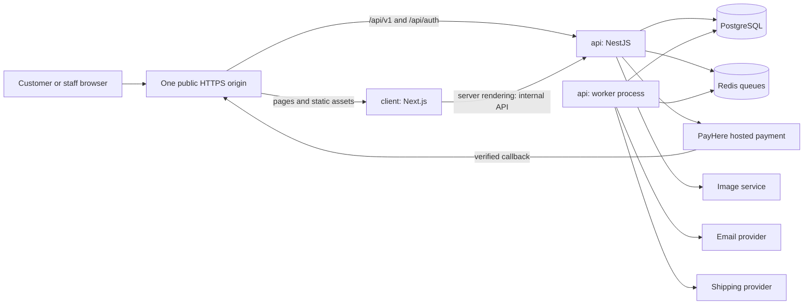
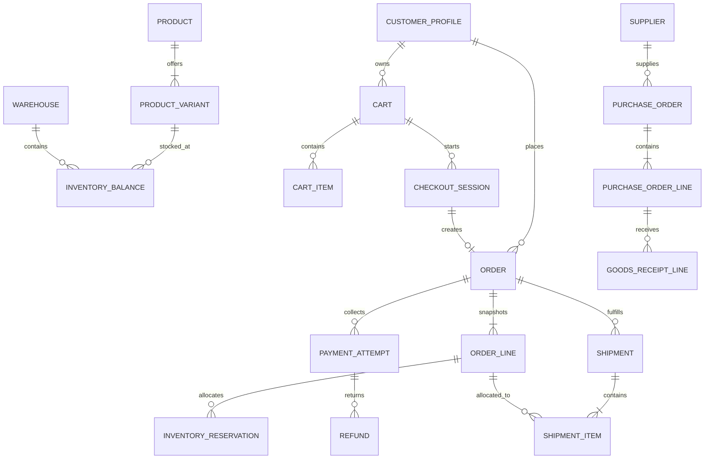

# Nithyakalyani Boutique — Full Custom Commerce Build Specification

**Document date:** 14 October 2026  
**Business:** Nithyakalyani Boutique, Sri Lanka  
**Purpose:** A self-contained implementation brief for a developer or a coding agent in VS Code.  
**Status:** Architecture and implementation specification. The application, migrations, integrations, and production deployment have not been built or verified by this document.

**How to use:** Upload this file alone to your VS Code coding agent, or keep it in the project root. The database, API, design, and acceptance specifications are included in full. The final section contains the implementation prompt.

**Contents**

1. [Instructions to the implementing agent](#1-instructions-to-the-implementing-agent)
2. [Business context and implementation boundaries](#2-business-context-and-implementation-boundaries)
3. [Chosen technology architecture](#3-chosen-technology-architecture)
4. [Target folder and file structure](#4-target-folder-and-file-structure)
5. [Configuration, local development, and provider modes](#5-configuration-local-development-and-provider-modes)
6. [Engineering and operational requirements](#6-engineering-and-operational-requirements)
7. [Business inputs and responsible defaults](#7-business-inputs-and-responsible-defaults)
8. [Implementation deliverables and completion rules](#8-implementation-deliverables-and-completion-rules)
9. [Detailed database specification](#9-detailed-database-specification)
10. [Detailed API contract](#10-detailed-api-contract)
11. [Experience, milestones, and acceptance criteria](#11-experience-milestones-and-acceptance-criteria)
12. [Official technical references](#12-official-technical-references)
13. [Prompt to start implementation in VS Code](#13-prompt-to-start-implementation-in-vs-code)

## 1. Instructions to the implementing agent

Build a complete, custom-coded saree commerce website from this specification. The two main application directories must be `api/` for the backend and `client/` for the frontend. Implement the public storefront and staff dashboard in `client/`. Implement commerce rules, persistence, authentication, integrations, and background processing in `api/`.

The owner has explicitly rejected Shopify and wants ownership of the application. Do not introduce Shopify, WooCommerce, Medusa, a hosted store builder, or another packaged commerce engine. Using maintained frameworks, an authentication library, a payment gateway, email delivery, image hosting, and managed infrastructure is appropriate.

Read the entire document before implementation. Work in the milestone order near the end. Complete working vertical slices with real persistence and appropriate tests. Do not stop after creating a homepage, a file tree, empty modules, static mock data, or an attractive dashboard without working operations.

1. Inspect the repository and applicable instructions. Preserve existing work and secrets.
2. Confirm installed runtime and dependency compatibility using current official documentation. Record exact selected versions in `docs/TECHNOLOGY_DECISIONS.md`; commit a lockfile. Use stable supported releases, not experimental releases chosen solely for novelty.
3. Establish the workspace, local infrastructure, database migrations, authentication integration, generated API contract, and first product-to-order flow before broadening the interface.
4. Make routine implementation decisions autonomously and record them. Ask only for business information that cannot be safely inferred, while continuing independent work.
5. Implement the approved local/demo scope without requiring production credentials. Keep adapters and fixtures explicit. Identify integrations awaiting credentials without claiming they work in production.
6. Keep `docs/IMPLEMENTATION_STATUS.md` current with completed milestones, changed files, commands actually run, failures, remaining work, and business inputs still needed.
7. At handoff, provide working startup instructions, test results, screenshots from real browser checks when available, and exact limitations. Never claim a test, payment, deployment, or verification occurred if it did not.

This specification defines engineering outcomes; it does not promise market leadership, search ranking, unlimited traffic, or commercial success. The product should earn customer trust through design quality, reliable operations, and honest information.

## 2. Business context and implementation boundaries

- Sarees are purchased from suppliers in India and sold by a Sri Lankan boutique.
- Fulfillment originates in Sri Lanka unless the owner later approves another stock location.
- Support Sri Lankan delivery and international delivery to explicitly enabled destinations.
- Launch as a single merchant, single brand. Include multiple stock locations in the schema, with one active default location initially.
- Base accounting currency is LKR. Preserve supplier purchase currency such as INR separately from LKR landed cost.
- Design for several customer languages; initially publish English. Tamil and Sinhala go live only after reviewed translations are supplied.
- The business controls products, variants, prices, stock, promotions, content, staff permissions, shipments, and customer service through its own admin dashboard.
- Products may have very limited quantities. Correct stock allocation is more important than decorative animation.
- Support guest checkout and optional customer accounts. Customers should not need an account to buy.
- Treat stitching, fall/pico, gift wrapping, and preorders as later features unless the owner confirms operational support. Do not advertise them as available by default.

### Launch scope

Deliver catalogue and search, product detail, wishlist, cart, checkout, approved payment methods, customer order access, order emails, fulfilment and tracking, returns/refunds, inventory and purchasing, promotions, CMS pages, and a role-controlled admin dashboard. Every visible control must work, have a real empty state, or be intentionally hidden until enabled.

### Deferred scope

AI styling chat, virtual try-on, recommendation models, native mobile apps, loyalty points, subscriptions, marketplace sellers, advanced accounting integration, and multi-warehouse routing are not launch dependencies. Add them only after the core store is measured and stable.

## 3. Chosen technology architecture

The explicit requirement for separate `api/` and `client/` applications takes precedence over the earlier suggestion to begin with a single Next.js application.

| Layer | Decision | Implementation rule |
| --- | --- | --- |
| Workspace | pnpm workspaces | Root contains `api`, `client`, and small shared `packages`; one lockfile. |
| Runtime | Supported Node.js LTS | Start by checking Node 24 LTS compatibility with all selected packages; pin an exact supported patch. |
| Language | TypeScript in strict mode | No unexplained `any`; validate untrusted input at boundaries. |
| Frontend | Next.js App Router + React | Server-render public content; isolate interactive components. |
| Styling | Tailwind CSS + selected shadcn/ui primitives | Build a boutique design system; customize primitives rather than shipping an unchanged dashboard theme. |
| Forms | React Hook Form + Zod | Accessible client validation; backend remains authoritative. |
| Client data | Generated REST client; TanStack Query for interactive/admin data | Fetch public content on the server when appropriate. Do not duplicate every request in both systems. |
| Localization | next-intl | Locale routes and messages; explicit country/currency controls are separate from language. |
| Backend | NestJS with its Express adapter | Modular commerce backend, HTTP server, and separate worker process from the same codebase. |
| Module format | ESM-compatible API build | Test the selected NestJS, Better Auth, TypeScript, and Prisma combination before feature work. |
| API | REST + OpenAPI | `/api/v1` for business APIs; generate client types and validate contract drift. |
| Database | PostgreSQL + Prisma | Relational source of truth; reviewed migrations, transactions, indexes, and explicit SQL constraints. |
| Authentication | Better Auth owned by the API | Generate its schema from the selected version/plugins; API enforces customer/staff access. |
| Jobs | BullMQ + Redis | Retries, order notifications, shipping tasks, reservation expiry, and reconciliation. |
| Media | Cloudinary adapter | Signed upload authorization; media metadata stored in PostgreSQL. |
| Email | Resend adapter | Transactional templates; local mailbox adapter for development. |
| Payments | PayHere adapter | Hosted card entry, verified notifications, refunds/reconciliation supported according to actual provider capabilities. |
| Shipping | Manual/local courier adapter; DHL Express adapter when contracted | Configurable zones and rates; service availability must be checked. |
| Logging/errors | Structured application logs + Sentry | Redact personal and payment data; attach request identifiers. |
| Tests | Vitest, API integration tests, Playwright, axe-core | Real PostgreSQL concurrency tests and real browser journeys. |
| Delivery | Docker Compose locally; deployable Docker images | Separate web, API, worker, database, Redis, and edge routing concerns. |
| CI | GitHub Actions | Type checks, lint, migrations, tests, production builds, and artifact checks. |

Select exact compatible versions during bootstrap. Avoid copying obsolete Prisma transaction examples from another major release. The implementation should document why a version was selected and any compatibility exception. Additional infrastructure such as Kafka, Kubernetes, Elasticsearch, or microservices requires a measured need.

### Application boundaries



- The API owns all business calculations and database writes. The frontend must not access Prisma or the commerce database.
- Public product data can be cached. Cart, checkout, orders, account pages, staff pages, and authenticated API responses must not enter shared caches.
- The API writes an outbox event in the same database transaction as an important state change. A worker reliably dispatches these events to queues. Redis is not the authoritative order ledger.
- Workers run as long-lived processes. Do not implement durable jobs by leaving a promise running after an HTTP response or relying on a browser staying open.
- Authentication lives only in `api/`; no second independent Next.js authentication server.
- Use one browser-facing origin. Locally and in production, route the fixed `/api/v1/*` and `/api/auth/*` prefixes to the API. The API should not also prepend those paths a second time.
- Proxy only known upstreams; never expose a general user-controlled URL proxy. Preserve `Set-Cookie`, appropriate headers, request IDs, and provider form bodies.
- For SSR, use an internal API URL. Forward a customer's session only when required and only to that configured backend. Do not cache authenticated responses.

## 4. Target folder and file structure

This is the structure the implementation agent must create incrementally. Files listed below are target deliverables, not a claim that this handoff already contains an application. Additional feature files are allowed when they improve separation of concerns.

```text
NKB/
|-- PROJECT.md
|-- README.md
|-- package.json
|-- pnpm-workspace.yaml
|-- pnpm-lock.yaml
|-- .node-version
|-- .npmrc
|-- .gitignore
|-- .editorconfig
|-- .env.example
|-- tsconfig.base.json
|-- eslint.config.mjs
|-- prettier.config.mjs
|-- compose.yaml
|-- .github/
|   `-- workflows/
|       |-- ci.yml
|       `-- deploy.yml
|-- api/
|   |-- README.md
|   |-- package.json
|   |-- tsconfig.json
|   |-- tsconfig.build.json
|   |-- nest-cli.json
|   |-- vitest.config.ts
|   |-- Dockerfile
|   |-- .dockerignore
|   |-- .env.example
|   |-- prisma.config.ts
|   |-- prisma/
|   |   |-- schema.prisma
|   |   |-- migrations/
|   |   `-- seed.ts
|   |-- src/
|   |   |-- main.ts
|   |   |-- worker.ts
|   |   |-- app.module.ts
|   |   |-- worker.module.ts
|   |   |-- config/
|   |   |   |-- env.schema.ts
|   |   |   `-- configuration.ts
|   |   |-- common/
|   |   |   |-- decorators/
|   |   |   |-- guards/
|   |   |   |-- filters/
|   |   |   |-- interceptors/
|   |   |   |-- pipes/
|   |   |   `-- security/
|   |   |-- database/
|   |   |   |-- database.module.ts
|   |   |   `-- database.service.ts
|   |   |-- auth/
|   |   |   |-- auth.ts
|   |   |   |-- auth.module.ts
|   |   |   |-- session.service.ts
|   |   |   `-- permissions.ts
|   |   |-- modules/
|   |   |   |-- catalogue/
|   |   |   |-- collections/
|   |   |   |-- pricing/
|   |   |   |-- inventory/
|   |   |   |-- suppliers/
|   |   |   |-- purchasing/
|   |   |   |-- customers/
|   |   |   |-- carts/
|   |   |   |-- checkout/
|   |   |   |-- orders/
|   |   |   |-- payments/
|   |   |   |-- shipping/
|   |   |   |-- returns/
|   |   |   |-- discounts/
|   |   |   |-- reviews/
|   |   |   |-- wishlists/
|   |   |   |-- content/
|   |   |   |-- media/
|   |   |   |-- notifications/
|   |   |   |-- staff/
|   |   |   |-- reports/
|   |   |   `-- settings/
|   |   |-- integrations/
|   |   |   |-- payments/{payment-provider,payhere-provider,fake-payment-provider}.ts
|   |   |   |-- shipping/{shipping-provider,manual-provider,dhl-provider}.ts
|   |   |   |-- media/{media-provider,cloudinary-provider,local-media-provider}.ts
|   |   |   `-- email/{email-provider,resend-provider,local-email-provider}.ts
|   |   |-- jobs/
|   |   |   |-- queues.ts
|   |   |   |-- processors/
|   |   |   `-- schedulers/
|   |   |-- outbox/
|   |   |-- audit/
|   |   |-- observability/
|   |   `-- health/
|   |-- scripts/
|   |   |-- export-openapi.ts
|   |   |-- create-admin.ts
|   |   `-- reconcile-payments.ts
|   `-- test/
|       |-- fixtures/
|       |-- integration/
|       |-- contracts/
|       `-- helpers/
|-- client/
|   |-- README.md
|   |-- package.json
|   |-- tsconfig.json
|   |-- next.config.ts
|   |-- next-env.d.ts
|   |-- postcss.config.mjs
|   |-- components.json
|   |-- Dockerfile
|   |-- .dockerignore
|   |-- .env.example
|   |-- public/
|   |   |-- brand/
|   |   |-- images/placeholders/
|   |   `-- icons/
|   |-- messages/{en,ta,si}.json
|   |-- src/
|   |   |-- app/
|   |   |   |-- layout.tsx
|   |   |   |-- globals.css
|   |   |   |-- error.tsx
|   |   |   |-- global-error.tsx
|   |   |   |-- not-found.tsx
|   |   |   |-- robots.ts
|   |   |   |-- sitemap.ts
|   |   |   |-- manifest.ts
|   |   |   |-- [locale]/
|   |   |   |   |-- layout.tsx
|   |   |   |   |-- loading.tsx
|   |   |   |   |-- (store)/
|   |   |   |   |   |-- page.tsx
|   |   |   |   |   |-- shop/page.tsx
|   |   |   |   |   |-- collections/[slug]/page.tsx
|   |   |   |   |   |-- products/[slug]/page.tsx
|   |   |   |   |   |-- search/page.tsx
|   |   |   |   |   |-- wishlist/page.tsx
|   |   |   |   |   |-- cart/page.tsx
|   |   |   |   |   |-- checkout/page.tsx
|   |   |   |   |   |-- checkout/return/page.tsx
|   |   |   |   |   |-- checkout/cancel/page.tsx
|   |   |   |   |   |-- order-access/page.tsx
|   |   |   |   |   |-- about/page.tsx
|   |   |   |   |   |-- contact/page.tsx
|   |   |   |   |   |-- care-guide/page.tsx
|   |   |   |   |   |-- journal/page.tsx
|   |   |   |   |   |-- journal/[slug]/page.tsx
|   |   |   |   |   |-- faq/page.tsx
|   |   |   |   |   `-- policies/[slug]/page.tsx
|   |   |   |   |-- (auth)/
|   |   |   |   |   |-- sign-in/page.tsx
|   |   |   |   |   |-- sign-up/page.tsx
|   |   |   |   |   `-- reset-password/page.tsx
|   |   |   |   `-- account/
|   |   |   |       |-- layout.tsx
|   |   |   |       |-- page.tsx
|   |   |   |       |-- orders/page.tsx
|   |   |   |       |-- orders/[id]/page.tsx
|   |   |   |       |-- addresses/page.tsx
|   |   |   |       `-- profile/page.tsx
|   |   |   `-- admin/
|   |   |       |-- layout.tsx
|   |   |       |-- sign-in/page.tsx
|   |   |       `-- (dashboard)/
|   |   |           |-- layout.tsx
|   |   |           |-- page.tsx
|   |   |           |-- products/
|   |   |           |-- collections/
|   |   |           |-- inventory/
|   |   |           |-- suppliers/
|   |   |           |-- purchases/
|   |   |           |-- orders/
|   |   |           |-- customers/
|   |   |           |-- discounts/
|   |   |           |-- returns/
|   |   |           |-- content/
|   |   |           |-- reports/
|   |   |           |-- staff/
|   |   |           `-- settings/
|   |   |-- components/{ui,layout,product,cart,checkout,account,admin,feedback}/
|   |   |-- features/{catalogue,search,cart,checkout,account,admin}/
|   |   |-- lib/{api,auth,formatting,seo,analytics}/
|   |   |-- hooks/
|   |   |-- i18n/{routing,request,navigation}.ts
|   |   |-- styles/tokens.css
|   |   `-- types/
|   `-- test/{components,helpers}/
|-- packages/
|   |-- api-client/{package.json,openapi.json,src/}
|   `-- config/{package.json,typescript,eslint}/
|-- tests/
|   |-- e2e/{storefront,checkout,account,admin}/
|   |-- accessibility/
|   `-- performance/
|-- playwright.config.ts
|-- infra/
|   |-- proxy/
|   |-- docker/
|   `-- deployment/
|-- scripts/{dev,check-env,wait-for-services}.mjs
`-- docs/
    |-- DATABASE.md
    |-- API_CONTRACT.md
    |-- EXPERIENCE_AND_ACCEPTANCE.md
    |-- TECHNOLOGY_DECISIONS.md
    |-- IMPLEMENTATION_STATUS.md
    |-- ASSET_REGISTER.md
    |-- SETUP.md
    |-- DEPLOYMENT.md
    |-- OPERATIONS.md
    `-- BUSINESS_INPUTS.md
```

Brace notation in the tree is shorthand for separate files or directories. Do not create a literal directory named `{...}`. Add the Next.js request-routing entry file (`proxy.ts` or the supported equivalent) appropriate to the installed version; exclude `/api`, `/admin`, assets, and framework internals from locale redirects. Root `/` redirects to the active default locale. The `/admin` public layout must not itself require a session; the `(dashboard)` layout protects staff screens without creating a sign-in redirect loop.

Each API feature should contain only necessary files, normally `<feature>.module.ts`, a controller, a service, DTOs, repository helpers where useful, and tests for important rules. Controllers parse and authorize; services implement use cases; database operations enforce invariants. Avoid abstract repository layers that merely duplicate every Prisma method.

## 5. Configuration, local development, and provider modes

### Environment contract

Commit example environment files containing placeholders only. Validate actual environment values at startup. Configuration names below are the project contract; map them explicitly to provider SDK settings.

| Scope | Variables |
| --- | --- |
| API core | `NODE_ENV`, `APP_ENV=local\|test\|staging\|production`, `PORT`, `PUBLIC_APP_URL`, `DATABASE_URL`, `MIGRATION_DATABASE_URL`, `REDIS_URL`, `LOG_LEVEL` |
| Authentication | `BETTER_AUTH_SECRET`, `BETTER_AUTH_URL`, `TRUSTED_ORIGINS` |
| Payments | `PAYMENT_PROVIDER=fake\|payhere`, `PAYHERE_MODE=sandbox\|live`, `PAYHERE_MERCHANT_ID`, `PAYHERE_MERCHANT_SECRET` |
| Shipping | `SHIPPING_PROVIDER=manual\|dhl`, `DHL_MODE=test\|live`, `DHL_ACCOUNT_NUMBER`, `DHL_API_KEY`, `DHL_API_SECRET` |
| Media | `MEDIA_PROVIDER=local\|cloudinary`, `CLOUDINARY_CLOUD_NAME`, `CLOUDINARY_API_KEY`, `CLOUDINARY_API_SECRET`, `LOCAL_MEDIA_ROOT` |
| Email | `EMAIL_PROVIDER=local\|resend`, `RESEND_API_KEY`, `EMAIL_FROM`, `LOCAL_SMTP_URL` |
| Observability | `SENTRY_DSN`, `SENTRY_ENVIRONMENT`, `RELEASE_VERSION` |
| Client server only | `API_INTERNAL_URL` |
| Client public | `NEXT_PUBLIC_SITE_URL`; optional consent-controlled analytics identifiers |

`BETTER_AUTH_URL` must match the externally reachable authentication configuration for the selected library version, including its configured base path. Local examples must use a consistent host (`localhost`, not a mix of `localhost` and `127.0.0.1`). Public runtime values contain no secrets. Configure supported currencies, countries, business identity, and shipping rules through validated settings and seed defaults rather than sprawling undocumented environment variables.

- Local Compose starts PostgreSQL, Redis, and a test mailbox. API listens on 4000, client on 3000; the browser uses the client origin and fixed API routing. The worker uses the same database and queue configuration as the API.
- Use a persistent Redis service compatible with BullMQ, not an HTTP-only Redis product. Production queues need appropriate persistence and `noeviction`; do not mix evictable cache data with critical queue storage without isolation.
- Local database users and fixtures are development-only. Production database, queue, and media storage must not be publicly exposed.
- A fake payment adapter may simulate approved, declined, canceled, pending, delayed, and duplicate notifications. It must follow the same application interface and state transitions as the real adapter.
- Fake payment routes, demo staff access, seeded test reviews, and debug controls must be unavailable when `APP_ENV=production`. Startup must fail for a production fake payment configuration. Production must also reject PayHere sandbox mode and local-only media/email providers unless a specific non-selling maintenance deployment has been deliberately designed.
- Manual shipping is a legitimate production adapter when staff book shipments themselves. It must still record tracking, shipment items, carrier, cost, and state changes.
- Providers must fail visibly and retry safely. Never silently convert a failed real payment into a successful demo payment.
- Local media stays within its configured workspace directory with validated filenames and MIME types. Store public product media only; keep customer documents private and protected if later introduced.

### Required root commands

Implement and document these scripts. They describe the finished repository's command contract; they do not exist in this specification-only handoff yet.

```text
pnpm install --frozen-lockfile
pnpm infra:up
pnpm env:check
pnpm db:generate
pnpm db:migrate
pnpm db:seed
pnpm admin:create
pnpm dev
pnpm lint
pnpm typecheck
pnpm test
pnpm test:integration
pnpm test:e2e
pnpm api:export
pnpm api:generate-client
pnpm build
```

On the first bootstrap there is no lockfile: run a normal install to generate it, then use frozen installs in CI and subsequent reproducible setup. Root `dev` must start client, API, and worker and terminate them cleanly. Use Node scripts or cross-platform tooling rather than Bash-only commands so Windows PowerShell works. Do not use destructive database resets as part of normal development startup. Separate the test database from development and production; destructive test setup must refuse non-test targets.

`admin:create` must use an explicit local command or controlled invitation and an interactive secret input where needed. Do not seed a universal administrator password, expose it in logs, or grant staff roles through public sign-up.

## 6. Engineering and operational requirements

### Authentication and authorization

Use the authentication library for password hashing, verification, recovery, sessions, and MFA. Do not invent a second credential store. Staff permissions belong to explicit database assignments and must be checked by the API on every protected operation. Secure, HttpOnly, host-only cookies are preferred; set `Secure` for HTTPS environments. Avoid access tokens in browser local storage.

Mount the Better Auth handler before body parsers according to its Express documentation. Apply ordinary API JSON parsing separately and preserve the PayHere form-encoded notification body. Test the whole integration, not just a standalone authentication example. Mutating cookie-authenticated commerce endpoints require CSRF defenses and trusted origin validation; third-party webhook endpoints instead require their provider-specific verification.

Use separate permissions for viewing orders, changing stock, issuing refunds, editing content, reading supplier costs, and administering staff. Require MFA for every production staff account, plus recent authentication for staff administration and sensitive refund actions. Commit staff audit events in the same transaction as the corresponding mutation or persisted provider command. Return a forbidden/not-found result when users request someone else's orders, addresses, returns, or wishlist entries.

### Pricing, stock, payments, and shipping

All final calculations occur on the server. Store integer minor currency units using database bigint and serialize them as integer strings. Use exact arithmetic; no floating point for financial calculations. Freeze item descriptions, prices, discounts, taxes, addresses, and selected delivery information on the order. Historical orders must survive later product or address edits.

Stock holds have expirations; paid allocations do not expire automatically. Payment state and shipping state are separate. Support payment retries without reserving stock twice or creating multiple customer orders. Retried callbacks must not repeat stock changes, emails, discounts, or shipment creation. Handle late payments and ambiguous provider timeouts explicitly.

Never promise payment currencies or worldwide destination coverage without configured support. A displayed currency conversion must be labeled as approximate when the customer will be charged in another currency. Show the actual charge currency and total before payment. Allow only destinations and delivery services the business can fulfill. Display whether import charges are included or collected separately according to owner-approved shipping policy.

### Search, caching, and SEO

Start with PostgreSQL-backed filters and indexed search. Normalize filter values; support fabric, weave, occasion, color family, price range, availability, and sort order. Scope searches to published products and active locale data. Support Unicode and benchmark Tamil/Sinhala queries before claiming language-aware relevance. Add a separate search engine only after measured catalogue/search needs justify it.

Use pagination and stable sorting. Product and collection updates invalidate relevant public caches. Product pages require canonical URLs, localized metadata where published, and truthful Product/Offer structured data. Variants, availability, and charge currency must agree with the page. Include only real approved reviews in review markup. Prevent indexing of admin, account, cart, checkout, private order links, and excessive filter combinations.

### Media and content

Use real licensed saree images for sale listings. Development assets must be labeled and tracked in `docs/ASSET_REGISTER.md` with owner/source/license/status. Generated lifestyle mockups must not falsely depict the exact item being sold. Record weave/provenance claims only when supplied and verified by the owner. Do not invent silk certifications, reviews, supplier endorsements, discounts, press coverage, or delivery promises.

Implement signed media uploads, file limits, accepted MIME types, transformations, and cleanup of abandoned uploads. Never expose provider API secrets in the frontend. Allow alt text, focal point, display ordering, draft/published state, and image reuse. An image should have one intentional transformation path to avoid paying for redundant optimization at multiple layers.

### Observability and recovery

- Structured JSON logs with request/correlation IDs, service, severity, release, and redacted context.
- Monitor API errors, checkout failures, callback verification failures, worker backlog, outbox age, stock reconciliation discrepancies, and provider failures.
- Mask addresses, emails where unnecessary, secrets, cookies, credentials, and card data in logs and traces. Exclude checkout/account/admin from session recording by default.
- Readiness checks verify required infrastructure without revealing connection strings. Liveness does not depend on optional providers.
- Database backups and point-in-time recovery where supported; perform and document an actual restore rehearsal before launch.
- Define retry ceilings, dead-letter/manual-review queues, and safe replay tools. External side effects need deduplication or reconciliation when a provider lacks idempotency support.
- Record refunds and shipments independently of provider availability so staff can see pending operations and recover them safely.

### Deployment topology

Provide two documented deployment paths: (1) Dockerized client, API, worker, and a reverse proxy on managed container hosting; (2) Vercel for `client/` with a managed long-running API and worker. Choose one target before launch and record it. The second path must preserve the same-origin `/api` routing and tested cookie behaviour. A plan is not a deployment.

Place API, worker, PostgreSQL, and Redis in the same suitable region to reduce transaction latency. Serve public assets through a CDN. Choose the region based on customer distribution and provider availability; do not claim a universally fastest region.

Use separate local, staging, and production configuration. Run migrations as a controlled one-off release step with the direct migration connection. Do not run development migration commands on production startup. Use forward-compatible expand/migrate/contract database changes; rollback must account for schema compatibility. Pin container versions, use non-root processes, health checks, resource limits, and graceful shutdown.

### CI and verification

CI must lint, typecheck, generate/validate Prisma artifacts, apply migrations to a fresh test database, run focused domain and API integration tests, compare generated OpenAPI/client artifacts, run browser tests, and build all deployable applications. Fail if generated contracts drift or a configured required integration is silently replaced by fake data.

Use actual PostgreSQL for locking/transaction tests; an in-memory substitute cannot verify these behaviours. Test duplicate and delayed callbacks, stock races, permission boundaries, cancellation/refund races, worker restarts, and provider timeouts. Browser tests cover both keyboard and touch-sized layouts. Measure page performance with realistic product images and dataset sizes. Record performance evidence as lab or field data accurately.

## 7. Business inputs and responsible defaults

Do not block local implementation on these inputs. Store unanswered items in `docs/BUSINESS_INPUTS.md` and build editable configuration plus explicit demo data. They become launch checks where relevant.

| Input needed | Development default | Before launch |
| --- | --- | --- |
| Logo and brand assets | Typographic wordmark using the real shop name | Owner-approved files and usage rights |
| Business contact/address | Clearly marked setup placeholders | Accurate public business details |
| Product catalogue/photos | Clearly marked demo records and licensed placeholders | Verified stock, descriptions, and sale images |
| PayHere account | Fake adapter locally; sandbox when available | Approved merchant, domain, currencies, settlement, and a verified real transaction/refund test |
| Delivery coverage/rates | Development-only zone fixtures | Contracted carriers, actual destinations, packaging weights, rates, and timing |
| Returns/privacy/terms | Drafts explicitly requiring owner review | Owner-approved policies suitable for actual operations |
| Tax configuration | No invented tax rules; demo-only configuration | Rates, applicability, invoices, and duties treatment confirmed by the business |
| Languages | English; translation keys for Tamil and Sinhala | Reviewed translations before publishing each locale |
| Domain/hosting/email | Localhost and test mailbox | Owned domain, HTTPS, verified sender, SPF/DKIM and appropriate DMARC configuration |
| Budget and support | Record provider selections without buying plans | Agreed operating budget, alert recipients, maintenance owner, recovery procedure |

The software should implement configurable tax and shipping rules after the owner supplies them. This document is not legal or tax advice and must not invent rules for Sri Lanka, India, or destination countries.

## 8. Implementation deliverables and completion rules

The final project must include the working storefront and staff dashboard, API and worker, real database migrations and seed fixtures, generated API client, integration adapters, sample configuration, meaningful automated tests, local startup, deployable images, and setup/operations documentation.

Maintain a status table using `not started`, `in progress`, `verified locally`, `verified in staging`, and `blocked on external input`. Each completed row needs evidence. External credentials may prevent live integration testing, but do not justify leaving unrelated local functionality unfinished.

Distinguish **local implementation complete** from **production ready**. A local fake-payment demo is a useful milestone; it is not a live store. The later acceptance section defines the complete milestone sequence and launch gates.

## 9. Detailed database specification

The database specification is embedded below so this file can be uploaded alone.

**Status:** implementation blueprint. No database has been created, migrated, seeded, or tested by this document.

Use PostgreSQL as the authoritative business database and Prisma for typed access and migrations. The NestJS API owns all domain writes. The Next.js client never connects directly to PostgreSQL. Keep the first release in one database; separate modules through code ownership and explicit service interfaces.

### 9.1 Schema conventions

- Domain primary keys: PostgreSQL `uuid`, generated server-side. Every mutable domain record has `created_at` and `updated_at` as `timestamptz`; timestamps are stored in UTC.
- Authentication primary keys and column types follow the generated Better Auth schema. Domain foreign keys to users must use its exact resulting ID type; do not assume those IDs are UUIDs.
- Use `text` for descriptive strings with application length limits, explicit PostgreSQL enums or checked text for finite states, `boolean` for flags, `integer` for quantities, and `jsonb` only for genuine structured snapshots/provider metadata.
- Store money as signed PostgreSQL `bigint` **minor units**, never floating point. Normal prices, charges, discounts, and refunds are nonnegative; signed amounts are reserved for ledger deltas and adjustments.
- Every monetary aggregate carries an ISO currency code and recorded currency exponent. The API serializes all monetary `bigint` values as base-10 strings, e.g. `{ "amountMinor": "1250000", "currency": "LKR", "exponent": 2 }`. Never convert money through JavaScript `Number`.
- Quantities are whole pieces for sarees. Use separate future measurement models for products sold by length; do not overload piece quantities with decimals.
- Exchange rates use `numeric(24,12)` and decimal strings in API responses. Record rate direction, source, timestamp, source currency, and target currency; never recompute historical orders using current rates.
- Add foreign keys for relationships and explicit indexes on foreign-key columns used in joins. PostgreSQL does not automatically supply every useful child-side FK index.
- Default deletion is `RESTRICT` for commercial records. Archive products/suppliers with `archived_at`; never cascade-delete orders, financial records, inventory movements, or audit history.
- Customer erasure/anonymization is a controlled workflow: preserve necessary transactional references and apply the approved retention policy. Do not invent a retention period in code.
- Prices, stock, totals, identity, permissions, and discount eligibility are computed/validated by the API. Client values are requests, never financial authority.
- Use database `CHECK` constraints and partial/functional indexes through reviewed SQL migrations where the ORM cannot express them. Inspect generated SQL before applying it.
- Public order references and supplier document numbers are human-readable identifiers; internal UUIDs remain stable keys. Do not expose sequential IDs as authorization mechanisms.

### 9.2 Primary relationships



### 9.3 Identity, customers, and access

| Table | Required fields, relationships, and rules |
|---|---|
| Generated authentication tables | Generate using the pinned Better Auth version and selected plugins/adapters during implementation. Its generated user/session/account/verification/MFA schema is authoritative. Commit reviewed schema and migrations. Do not hand-design replacement auth tables from this document. |
| `customer_profile` | `id uuid`, optional unique `auth_user_id` FK, `display_name text`, optional phone, `preferred_locale text` default `en`, marketing preferences with evidence recorded separately. Guest orders may have no profile. |
| `customer_address` | `id`, `customer_id` FK, recipient, country code, region, city, postal code nullable according to destination, address lines, phone, label, `is_default_shipping boolean`. Partial unique default per customer. Changes never alter past orders. |
| `role` / `permission` | Unique stable `key text`; role examples `OWNER`, `ADMIN`, `CATALOG_MANAGER`, `FULFILLMENT`, `SUPPORT`, `ANALYST`. Permissions are action/resource keys, not client page visibility flags. |
| `role_permission` / `user_role` | Composite primary keys over the two FKs. `user_role` records granting actor and timestamp. Server checks permissions for every protected operation. |
| `consent_event` | Optional customer/auth user FK, purpose, channel, policy version, `granted boolean`, evidence source, occurred timestamp. Append-only changes; collect only necessary evidence. |
| `customer_note` | Customer FK, staff author FK, bounded plain-text note, timestamps. Staff-only; exclude from storefront APIs and analytics exports. |
| `guest_order_access_challenge` | Order FK, purpose `ORDER_ACCESS`, unique token hash or peppered code hash, expiry, failed-attempt count, consumed/revoked timestamps. Store only the hash; scope verification to the order's recorded email and a bounded attempt limit. |
| `guest_order_access_grant` | Order FK, unique opaque credential hash, explicit permitted order actions, expiry, revoked timestamp, optional originating challenge FK. The random credential is issued in a scoped HttpOnly cookie; no cross-order enumeration or account/staff capability. Index order/expiry and credential hash. |

Configure staff MFA and session revocation using the selected authentication integration. Do not duplicate passwords, raw session secrets, or reset tokens in domain tables. A user cannot grant themselves permissions through profile mutations. Prevent removing the final active owner through a locked administrative transaction.

Creating an order may issue one grant to its authenticated guest-checkout context. Recovery creates a bounded challenge and generic response; successful verification consumes the challenge and creates the scoped grant atomically. Single-use exchange tokens cannot become permanent bearer credentials. Guest grants never attach orders to a customer account without a separate verified claiming flow.

### 9.4 Catalogue and product discovery

| Table | Required fields, relationships, and rules |
|---|---|
| `product` | `id`, unique `slug`, `status` (`DRAFT`, `ACTIVE`, `ARCHIVED`), default title/description, `brand text`, `origin_country_code`, optional supplier reference, `published_at`, `archived_at`. Only active published records appear publicly. |
| `product_variant` | `id`, `product_id` FK, unique normalized `sku`, optional unique barcode, title, `active boolean` default true, `weight_g integer > 0` when shipping enabled, optional packed dimensions in mm, `version integer` default 1. Archive; never remove referenced variants. |
| `variant_price` | Variant FK, currency, exponent, `amount_minor bigint >= 0`, optional compare-at amount, `valid_from`, optional `valid_until`. A checkout selects exactly one applicable price; reject overlapping active validity windows per variant/currency. |
| `saree_details` | Unique product FK; material composition, weave, craft description, saree length/width in mm, blouse-piece included boolean, optional blouse length, care instructions, transparency and drape notes. Claims must be supplied/verified by the merchant. |
| `attribute_definition` / `attribute_value` | Unique keys and typed values for fabric, weave, occasion, colour family, pattern, finish. Use controlled values for filters. |
| `product_attribute` / `variant_attribute` | Join rows with product/variant FK, attribute FK, value FK; unique owner/value pair. Enforce that selected values belong to their declared attribute. Variant-specific colour/size overrides must be explicit. |
| `product_option` / `product_option_value` | Options such as colour and blouse configuration, ordered within a product. Unique option key per product and value key per option. |
| `variant_option_value` | Variant FK plus option/value FK; one value per variant/option. Verify every option belongs to the variant's product and every value to its option. |
| `category` / `product_category` | Hierarchical categories with unique slug, optional parent FK, sort order; join unique product/category pair. Reject cycles. |
| `collection` / `collection_product` | Curated collection slug, title, status, publication window, ordered product membership. Start with explicit membership, not an opaque rule engine. |
| `media_asset` / `product_media` | Provider asset ID unique, public delivery reference, resource type, pixel dimensions, duration if video, alt text, position, optional variant FK. Store provider IDs rather than permanent signed URLs. |
| `product_translation` / `category_translation` / `collection_translation` | Unique owner/locale, translated title, description, SEO title and description, approval/publication status. Untranslated or unapproved content is never published under that locale. |
| `wishlist` / `wishlist_item` | Customer FK; items reference products, with unique wishlist/product pair. Variant selection occurs when buying. Public sharing is a separate opt-in feature, disabled by default. |

Store a canonical option signature on each variant and enforce unique `(product_id, option_signature)` to prevent duplicate variants. Compute it server-side from sorted option/value IDs. Common browse indexes: product `(status, published_at)`, category membership `(category_id, product_id)`, prices `(currency, variant_id)`, attribute membership `(attribute_value_id, product_id)`. Start search with a maintained PostgreSQL search document and suitable index; external search is a replaceable projection, never the source of prices or stock.

Expose only locales with approved interface translations. If requested catalogue/editorial content lacks an approved translation, explicitly redirect to its English URL and use that English canonical URL; do not serve English content as a published Tamil/Sinhala translation or emit a false alternate-language link. Draft-editor fallback may show English with a clear internal label.

### 9.5 Suppliers, purchasing, and landed cost

| Table | Required fields, relationships, and rules |
|---|---|
| `supplier` / `supplier_contact` | Supplier name, country, currency preference, contact details, archive timestamp; normalized external supplier code unique when present. Restrict access to commercial terms. |
| `supplier_variant` | Supplier/variant pair unique, supplier SKU, quoted cost/currency, lead-time estimate. Quotes do not replace receipt-time cost snapshots. |
| `purchase_order` | Unique reference, supplier FK, source currency/exponent, status `DRAFT`, `ORDERED`, `PARTIALLY_RECEIVED`, `RECEIVED`, `CANCELLED`; expected dates, supplier document reference. |
| `purchase_order_line` | PO FK, variant FK, ordered quantity `> 0`, unit purchase cost in source currency, description snapshot. Received quantity is derived from posted receipts. |
| `goods_receipt` / `goods_receipt_line` | PO/supplier reference, warehouse FK, status `DRAFT` or `POSTED`, posted timestamp/actor; lines link PO line, variant, accepted/rejected quantities, original purchase cost/currency and its base-LKR total/FX snapshot. `cost_status` is `PENDING` or `FINALIZED`, with cost version and finalization timestamp. Posting creates stock movements exactly once. |
| `import_consignment` | Supplier/shipment references, source and settlement currencies, FX snapshot, arrival date and merchant-supplied document references. Link receipts through `consignment_receipt`. |
| `landed_cost_charge` | Consignment FK, charge category, original amount/currency, base-currency amount, FX snapshot, allocation method, document reference. Charges include actual freight or other merchant-recorded costs; do not assume rates. |
| `landed_cost_allocation` | Charge FK plus receipt-line FK, base-currency allocated amount. Sum of allocations must equal the charge, including deterministic rounding remainder. Unique charge/receipt-line pair. |
| `cost_adjustment` | Receipt-line FK, signed amount in base currency, reason, actor, timestamp. Post adjustments instead of rewriting closed receipt costs. |

Lock purchase-order lines while posting receipts. Reject over-receipt unless an authorized, audited override is specified. Finalize receipt cost only after all recorded consignment charges are allocated, or after staff explicitly confirm there are no additional charges. Initial margin reporting uses the indicative acquisition-cost snapshot below; formal COGS, inventory valuation, and a full accounting ledger are outside the first release. Every stock receipt and adjustment must have a traceable source document.

### 9.6 Inventory, reservations, and concurrent checkout

| Table | Required fields, relationships, and rules |
|---|---|
| `warehouse` | Unique code, name, address, active flag. Start with one Sri Lankan location; preserve multi-location relationships. |
| `inventory_balance` | Composite unique `(variant_id, warehouse_id)`, `on_hand integer` default 0, `reserved integer` default 0, `version integer` default 1. Check `on_hand >= 0`, `reserved >= 0`, `reserved <= on_hand`. Available = on_hand − reserved. |
| `inventory_movement` | Variant/warehouse FKs, signed `on_hand_delta`, signed `reserved_delta`, movement type, source type/ID, unique deduplication key, reason, actor, occurred timestamp. Immutable; balance update and movement insertion share one transaction. |
| `inventory_reservation` | Order-line and checkout FKs, variant/warehouse FKs, requested quantity `> 0`, fulfilled/released quantities default 0, state `ACTIVE`, `ALLOCATED`, or `CLOSED`, expiry for active holds, optional close reason. Held = requested − fulfilled − released. Check held >= 0. |
| `inventory_adjustment` | Warehouse FK, status `DRAFT`/`POSTED`, reason, staff actor, posted timestamp, unique posting idempotency key. |
| `inventory_adjustment_line` | Adjustment/variant FKs, nonzero signed quantity delta, reason, unique adjustment/variant pair. Posting appends exactly one movement per line under balance locks; negative changes cannot reduce stock below reserved quantities. |

Reservation protocol:

1. Reprice and validate checkout on the server, then lock all affected balance rows in a stable `(warehouse_id, variant_id)` order. Insert missing balance rows safely before locking.
2. Verify availability for every line inside the transaction. Update reserved quantities, insert reservations/movements, create the pending order, and enqueue outbox work atomically. Any failure rolls back the whole operation.
3. Choose a configurable short payment hold duration (initial default 15 minutes), recorded in `expires_at`. This is a business setting, not a promise of provider payment timing.
4. Payment success locks the payment/order/reservations and balances. If holds remain valid, change reservations to `ALLOCATED`, remove expiry, and keep reserved stock until dispatch or cancellation.
5. An expiry worker closes only eligible `ACTIVE` holds under locks, increments released quantities, and decreases reserved balances exactly once. Index `(state, expires_at)` for eligible rows.
6. A late successful payment must never resurrect expired holds blindly. Atomically acquire currently available stock; when all lines can be reacquired, allocate and confirm. Otherwise retain the recorded successful payment, set a fulfillment exception, and create a refund obligation or staff action with a deadline.
7. Dispatch moves quantities from reserved and on-hand together, increments reservation fulfilled quantities, and links the movement to shipment items. Partial dispatch leaves the remaining quantity allocated.
8. Cancellation releases only unfulfilled held quantities. Returns increase stock only after a separate received/inspection decision. A refund alone never restocks a saree.

`ACTIVE -> ALLOCATED -> CLOSED` and `ACTIVE -> CLOSED` are allowed. `CLOSED` is terminal; a new allocation requires a new reservation record. Close reasons include `FULFILLED`, `EXPIRED`, `CANCELLED`, and `MIXED`. Every non-closed row has held quantity > 0; a closed row has held quantity 0. Lock and recheck at every transition. Retry deadlocks/serialization conflicts with bounded backoff and the same business idempotency key. Redis must never be the only protection against overselling.

### 9.7 Cart, checkout, and order snapshots

| Table | Required fields, relationships, and rules |
|---|---|
| `cart` | Customer FK nullable, anonymous token **hash** nullable, optional selected promotion-code FK, currency, state `ACTIVE`, `CONVERTED`, `ABANDONED`, expiry, version. Bind guest access to a protected random credential, not cart ID alone. Stored coupon selection does not guarantee eligibility. |
| `cart_item` | Cart/variant FKs, quantity `> 0`, unique cart/variant pair. Display price is provisional; recalculate at checkout. |
| `checkout_session` | Cart FK and captured cart version, status `OPEN`, `PAYMENT_PENDING`, `COMPLETED`, `EXPIRED`, `CANCELLED`; currency, locale, quote snapshot immutable from creation, calculation version, `quote_expires_at`, nullable `submitted_at`, shipping quote reference, terms version accepted and timestamp. API `quoteId` is this row's ID; every re-quote creates a new session. Lifecycle metadata can change; quoted terms cannot. |
| `order` | Unique public reference, unique checkout FK, unique source-cart FK, optional customer FK, email/phone snapshot, currency/exponent, lifecycle status, payment/fulfillment summaries, separate `financial_flag` (`NONE`, `DISPUTED`, `REVIEW_REQUIRED`), fulfillment exception code nullable, subtotal/discount/shipping/shipping-discount/tax/order-credit/grand-total minor units, placed timestamp. |
| `order_address` | Order FK, kind `SHIPPING`/`BILLING`, unique order/kind; complete immutable recipient/address/phone snapshot. Do not FK live address content as the historical record. |
| `order_line` | Order FK, nullable historical product/variant FKs with deletion restricted while referenced, SKU/title/options snapshot, product image reference, quantity `> 0`, unit price, gross amount, discount amount, tax amount, net amount, captured tax treatment, product origin/weight snapshot. |
| `order_line_cost_snapshot` | Unique order-line FK, status `AVAILABLE`/`UNAVAILABLE`, base currency `LKR` and exponent 2, method `LATEST_FINALIZED_RECEIPT`, method version, source receipt-line FK nullable, source cost version, immutable allocation/adjustment references, snapshot timestamp, quantity, estimated unit/total cost minor units nullable. Staff-only; captured once at order confirmation. |
| `order_adjustment` | Order FK, kind, signed amount, reason, actor, approved timestamp; immutable compensating changes for authorized post-order corrections. Never silently mutate captured line prices. |
| `order_cancellation_request` | Order FK, requester identity or guest grant FK, requested line quantities in child `order_cancellation_request_item` rows, reason, status `REQUESTED`, `APPROVED`, `REJECTED`, decision actor/timestamp. Unique request idempotency key; request alone does not release stock or refund money. |
| `order_line_cancellation` | Order-line FK, optional cancellation-request FK, quantity `> 0`, reason, actor, timestamp, unique business-operation key, optional `payment_reconciliation_issue_id` FK for collected funds needing refund. Sum cannot exceed purchased quantity minus dispatched quantity. |
| `order_tax_component` | Order FK, optional order-line FK, shipping/merchandise scope, merchant-configured jurisdiction/category label, rate snapshot, taxable base and tax amount minor units, calculation version. Components reconcile to stored tax totals; capture zero/exempt treatment explicitly. |
| `order_status_event` | Order FK, old/new status, reason, actor/system source, occurred timestamp. Append-only. |
| `order_note` | Order FK, staff author FK, bounded plain-text body, timestamps. Staff-only; edits/deletions are audited and never enter customer API responses. |

For an indicative cost snapshot, select the variant's latest posted receipt line with accepted quantity > 0 and finalized fully allocated costs at confirmation time, ordered by receipt `posted_at DESC`, then receipt-line ID for a deterministic tie-break. Compute `(base purchase total + allocated charges + posted cost adjustments) / accepted quantity` with exact decimal arithmetic, round half-up to LKR minor units once, and set estimated total = rounded unit cost × ordered quantity. Snapshot all input references/version; later receipts and cost adjustments never rewrite it. If no eligible cost exists, record `UNAVAILABLE`, keep amounts null, and exclude that line from estimated-margin totals with an explicit coverage warning. Label reports **estimated acquisition margin**, not COGS, profit, or formal inventory valuation. Refunds/cancellations are separate report adjustments, not edits to the original snapshot.

At submission, persist every price/discount/shipping/tax decision in the order. Money totals and all components must share the order currency. The model uses merchandise gross = sum(unit price × quantity); merchandise net = gross − allocated merchandise discount; tax is stored **exclusive** of those net amounts; grand total = merchandise net + shipping net + tax total − explicitly recorded order credit. If prices are displayed inclusive of tax, the server first extracts the exclusive amount with the configured rounding rule and snapshots the inclusive display amount. Do not add included tax twice.

Allocate order-wide discounts and rounding remainders deterministically to lines. Record shipping discounts separately. No line discount may exceed eligible line gross. Capture the calculation version and rounding method; recompute and reject client totals. Avoid a generic editable `total` field with no component reconciliation.

Order lifecycle: `PENDING_PAYMENT -> CONFIRMED -> PROCESSING -> COMPLETED`; cancellation is allowed only with recorded treatment for remaining stock and collected funds. `COMPLETED` means all fulfillable lines dispatched or explicitly resolved; it is not inferred from payment alone. Keep refund and return state separate from order lifecycle. Guest order retrieval uses a short-lived verified access flow; a guessable order reference plus email is insufficient.

Allow `PENDING_PAYMENT`, `CONFIRMED`, or `PROCESSING` to become `CANCELLED` only when no line was dispatched and all remaining quantities are cancelled. For partly dispatched orders, record cancellations per line and resolve the remaining lifecycle normally. A late capture on an explicitly cancelled order creates a refund obligation; it must not automatically reopen fulfillment. Original order totals remain immutable: adjustments, cancellations, refunds, and the current balance due are separate projections of recorded events.

Quote expiry only controls whether an `OPEN` session may be submitted. Payment reservation expiry is stored separately on active inventory reservations. After submission, do not release stock merely because the original quote expired. Lock the source cart and validate its captured version before changing `ACTIVE` to `CONVERTED`; source-cart uniqueness prevents separate quotes or idempotency keys from creating duplicate orders for one cart. Later shopping starts a new active cart.

### 9.8 Payments, callbacks, and refunds

| Table | Required fields, relationships, and rules |
|---|---|
| `payment_attempt` | Order FK, provider, unique provider merchant reference, provider transaction ID nullable with provider-scoped uniqueness, amount/currency, state `CREATED`, `PENDING`, `SUCCEEDED`, `FAILED`, `CANCELLED`, `EXPIRED`; submitted/settled timestamps, safe error category. Multiple attempts are allowed; only an authorized payable amount may be collected. |
| `payment_provider_event` | Provider, event ID when supplied, deterministic provider-scoped dedupe key, payload hash, verified flag, processing state, safe redacted payload, received/processed timestamps. Unique dedupe key. Follow provider retry/signature semantics. |
| `payment_transaction` | Attempt FK, kind `CAPTURE`, `REFUND`, `CHARGEBACK`, `REVERSAL`, positive amount/currency, unique provider operation reference, optional original-transaction FK, occurred timestamp. Immutable financial fact distinct from a mutable attempt state. A `REVERSAL` references the exact financial event it negates. |
| `refund` | Order/payment attempt FK, optional return-request and reconciliation-issue FKs, request idempotency key unique, amount/currency, status `REQUESTED`, `SUBMITTED`, `SUCCEEDED`, `FAILED`, `UNKNOWN`; reason, provider refund reference, actor, timestamps. |
| `refund_allocation` | Refund FK, order-line FK nullable for explicit shipping/adjustment allocation, amount, quantity when relevant, allocation kind. Allocations sum to refund amount. |
| `payment_reconciliation_issue` | Order FK, attempt FK when known, issue code, optional required-refund amount/currency, observed facts, state `OPEN`/`RESOLVED`, due timestamp, resolution evidence. This is the persisted refund-obligation reference used by cancellations/returns. Includes duplicate capture, amount/currency mismatch, late success without stock, chargeback, and unknown provider outcome. |

Persist and verify provider callbacks on the API. Match merchant reference, expected amount, currency, and provider authenticity before recording success. A redirect or client success page is not payment evidence. Store no PAN, CVV, or unredacted card data.

Callbacks may repeat or arrive out of order. A payment success is a durable fact: a later failed/pending event cannot downgrade it. If an attempt previously appeared expired/failed but a verified successful transaction arrives, record the capture and run reconciliation. Simultaneous successful attempts for one order must record both financial facts, apply only the intended payable amount, and create an explicit duplicate-payment refund obligation for excess funds.

Lock the order/payment aggregate before issuing refunds. Compute net funds by adding captures, subtracting successful refunds and chargebacks, and applying each linked reversal with the opposite sign of its original event. Subtract reserved in-flight/unknown refund requests from that balance before allowing a new refund. Keep `UNKNOWN` amounts reserved until provider reconciliation; retry with the same provider-supported idempotency key. A timeout does not prove a refund failed. Block new refunds during an unresolved dispute; do not return money a second time when a chargeback already removed it.

Order payment summary is derived from financial facts: `UNPAID`, `PAID`, `PARTIALLY_REFUNDED`, `REFUNDED`. Expose pending/failed attempts separately. Unexpected underpayments/overpayments create reconciliation issues and do not silently confirm the order. Enqueue receipt, fulfillment, or refund work through the transactional outbox.

A verified provider chargeback notification (PayHere status `-3`) appends a deduplicated `CHARGEBACK` fact, opens reconciliation, sets `financial_flag=DISPUTED`, and blocks undelivered fulfillment. Preserve the historical successful attempt/capture; a chargeback is not a merchant refund and must not set `REFUNDED`. Payment summary describes accepted capture/merchant-refund history, while the separate flag and net funds calculation expose dispute impact. Only verified resolution may append a linked `REVERSAL` or clear the flag; do not infer resolution from an older success callback.

### 9.9 Shipping, fulfillment, and returns

| Table | Required fields, relationships, and rules |
|---|---|
| `shipping_zone` / `shipping_method` | Explicit country/region coverage, enabled services, merchant-configured rate rules, currency, transit estimate text. No worldwide availability assumption. |
| `shipping_quote` | Checkout FK, provider/service reference, destination/package hash, price/currency, expiry, provider quote reference, recorded duties/tax responsibility display text. Invalidate after relevant address/cart changes. |
| `shipment` | Order/warehouse FKs, carrier/service, status `DRAFT`, `BOOKING_PENDING`, `READY`, `DISPATCHED`, `DELIVERED`, `CANCELLED`, `EXCEPTION`; unique provider booking key, tracking number, label asset reference, dispatch/delivery timestamps; nullable actual carrier-cost minor units/currency/exponent and cost-recorded timestamp. Unknown cost is null, not zero. Customer shipping charge remains the independent order snapshot. |
| `shipment_item` | Shipment FK, order-line FK, reservation FK, quantity `> 0`, unique shipment/order-line/reservation tuple. Product identity and order must match referenced line/reservation. |
| `tracking_event` | Shipment FK, provider event dedupe key unique, provider status, normalized status, location text, occurred/received timestamps. Preserve event history; do not regress delivery status on older events. |
| `return_request` / `return_item` | Order FK, state `REQUESTED`, `AUTHORIZED`, `RECEIVED`, `INSPECTED`, `CLOSED`, `REJECTED`; line quantities and reasons, inspection outcome and restock disposition; optional reconciliation-issue FK for a refund obligation. Actual refunds link back through `refund.return_request_id`. |

Lock order lines/reservations during allocation and dispatch. Sum of quantities across all non-cancelled shipment allocations cannot exceed purchased quantities minus documented cancellations; dispatch cannot exceed the held reservation quantity. Dispatch requires accepted payment and no blocking fulfillment exception. Cancelled draft shipments release their shipment allocation, but do not automatically cancel the order reservation. Bookings and labels use idempotent background jobs; never hold a database transaction open during carrier network calls.

Fulfillment summary: `UNFULFILLED`, `PARTIALLY_FULFILLED`, `FULFILLED`. Calculate from dispatched line quantities and documented cancelled quantities. Track returns separately so historical fulfillment remains auditable. Returned stock enters sellable inventory only after inspection, with a distinct movement and deduplication key.

### 9.10 Discounts, reviews, content, and settings

| Table | Required fields, relationships, and rules |
|---|---|
| `promotion` | Type `PERCENTAGE`/`FIXED`, basis points or amount/currency, active dates, minimum spend, maximum discount, global/per-customer limits, stacking policy, status, eligibility version. Check valid ranges. |
| `promotion_code` | Promotion FK, normalized uppercase code unique, activation window/status. Store normalization consistently. |
| `promotion_eligibility` | Explicit product/category/collection scope relationships; product eligibility is snapshotted when checkout is submitted. |
| `promotion_redemption` | Promotion/code FK, checkout/order FK, customer eligibility key, state `RESERVED`, `COMMITTED`, `RELEASED`, expiry, amount/currency. Unique promotion/checkout pair. |
| `review` | Customer and product FKs, purchased order-line FK, rating integer 1–5, title/body, status `PENDING`, `PUBLISHED`, `REJECTED`, timestamps; unique customer/order-line pair. |
| `review_media` / `review_moderation_event` | Review/media references and append-only staff decisions. Uploaded media must pass configured validation. |
| `content_page` / `content_page_translation` | Unique page key and owner/locale pair; versioned structured content, draft/published status, title/SEO fields, publish timestamp. Sanitize rendered rich text. |
| `homepage_section` | Stable key, type, validated JSON configuration, position, publication window/status, locale-specific content. Validate referenced products and media. |
| `store_setting` | Namespaced unique key, validated non-secret JSON value, version, updated actor. Secrets belong in the deployment secret store, not this table. |

Reserve promotion usage with row locks in the same transaction as order placement. Check committed plus unexpired reserved usage against global/per-customer caps; release on checkout expiry and commit on accepted payment. Late payment must not bypass limits: a captured payment may retain its agreed discount while producing a reconciliation action under the merchant's explicit policy. Never retrospectively charge an unapproved higher amount.

Verified reviews require authenticated ownership of a paid, fulfilled order line for the reviewed product; calculate verification server-side. Review editing must not alter the owner or purchased-line reference. Define whether guest purchasers can claim accounts through a verified flow before reviewing. Anonymous email strings are not proof of purchase.

### 9.11 Reliability and audit records

| Table | Required fields, relationships, and rules |
|---|---|
| `outbox_event` | UUID, aggregate type/ID, event type/version, minimal JSON payload, occurred timestamp, available timestamp, attempt count, lease owner/expiry, processed timestamp. Index unprocessed availability. Insert in the business transaction. |
| `consumer_inbox` | Consumer key + event ID composite unique, handled timestamp. Each consumer records completion with its business effects where possible. |
| `idempotency_record` | Scope, principal identifier, key, request hash, state, safe response/resource reference, lease/expiry timestamps; unique scope/principal/key. Same key with different request hash returns conflict. |
| `audit_event` | Actor/system identifier, action, resource type/ID, minimal redacted before/after changes, correlation ID, timestamp. Append-only; restrict read/export permissions. |
| `notification_delivery` | Event/order reference, channel/template/version, recipient reference, provider message ID, state, attempts, last safe error; unique business event/channel/template combination. |

Use at-least-once job delivery with idempotent effects. Claim outbox work with short database transactions and expiring leases; perform network calls outside those transactions. Keep durable unfinished work recoverable after process restarts. Do not promise exactly-once behavior across external providers. Log correlation IDs without tokens, sensitive provider secrets, or full address payloads.

Every audited mutation commits its audit row in the **same database transaction** as the domain change; failure to write that audit row rolls back the mutation. For external actions, commit command/status, audit, and outbox rows before making the network request, then record each verified result transition and its audit atomically. Do not rely on a best-effort log call after returning success.

### 9.12 Migrations, seeds, reconciliation, and acceptance

- Commit versioned migrations, constraints, indexes, and reviewed generated auth schema. Run migrations once from a controlled deployment step; do not have each API instance race migrations at startup.
- Test against real PostgreSQL in CI. SQLite cannot establish the production locking/constraint behavior described here.
- Seed roles/permissions, supported currencies/locales, one warehouse, and clearly fictional development products. Never seed a shared production admin password, real customer data, or fabricated customer reviews.
- Provision the first owner through a documented one-time secure bootstrap/invitation process, then disable bootstrap access.
- Reconcile inventory balances against movement totals and current held reservations; report drift without silently rewriting history.
- Reconcile order totals against immutable line/adjustment allocations and payment/refund facts. Alert on negative availability, duplicate capture, overdue refund issues, and stuck outbox jobs.
- Set documented backup, point-in-time recovery, recovery-time, and recovery-point targets; perform an actual restore rehearsal before launch.
- Required concurrent tests: two buyers/one saree; simultaneous cart retry; payment versus hold expiry; late payment with unavailable stock; duplicate/out-of-order callbacks; two successful payment attempts; two concurrent refunds; partial shipment dispatch; receipt replay; last available coupon redemption.
- Required invariant tests: no overselling, no negative available stock, no refund above captured funds, no duplicate order for one submitted checkout, no unauthorized review verification, immutable historical prices/addresses, no double stock movement from job replay.
- Add migration acceptance checks for money types/serialization, all unique deduplication keys, foreign-key deletion rules, timezone handling, indexed high-volume lookups, and safe rollback/forward-repair procedures.

**Implementation handoff:** translate this specification into a reviewed Prisma schema plus SQL migrations and service-level invariants. Document any deliberate deviations in an architecture decision record. A schema file alone is not evidence that payment, inventory, authorization, or concurrency behavior has been implemented correctly.

## 10. Detailed API contract

The API contract is embedded below so this file can be uploaded alone.

Status: implementation specification, not a claim that any endpoint already exists.
Business REST prefix: `/api/v1`. Authentication prefix: `/api/auth`.
Implement this contract in `api/`; consume its generated client from `client/`.

### 10.1 Transport, ownership, and security

- Use NestJS with its Express adapter and TypeScript ESM; run the API and worker as separate processes from the same `api/` codebase.
- Only the API owns PostgreSQL/Prisma access, authentication, authorization, price calculation, inventory, and integration secrets.
- Expose the storefront and API through one HTTPS public origin. Route only `/api/v1/*` and `/api/auth/*` to the configured API upstream.
- Do not implement a generic URL proxy. The API origin is deployment configuration, never a browser-supplied destination.
- Mount Better Auth before body parsing; configure the NestJS bootstrap accordingly. Use the wildcard syntax supported by the installed Express version.
- Keep one Better Auth instance in `api/`. The Next.js application uses its client/session interfaces and must not create a second authentication server.
- Use Secure, HttpOnly, host-only session cookies in production with a documented SameSite policy, expiry, rotation, and logout invalidation.
- Validate trusted origins and a CSRF token on cookie-authenticated business mutations, including guest cart and checkout mutations.
- `GET /api/v1/csrf` establishes/uses an actor-bound session or guest context and returns its CSRF token with `no-store`; submit it in `X-CSRF-Token` and validate server-side.
- Keep Better Auth's own CSRF/origin defenses enabled. The payment notification route is exempt from browser CSRF and instead verifies the provider message.
- Server rendering may forward the required session cookie only to an allowlisted internal API origin; never forward cookies through arbitrary fetch URLs.
- The API must authorize every resource operation. UI hiding, unguessable IDs, and Next.js route checks are insufficient authorization.
- Apply request-body limits, strict DTO validation, parameterized queries, structured redacted logs, and correlation IDs.
- Use exact CORS origin allowlists only when deployment genuinely requires cross-origin requests. Never combine credentials with a wildcard origin.
- Return account, cart, checkout, order, payment, and admin responses with `Cache-Control: private, no-store`.
- Cache only anonymous catalogue/content responses; never share a response cache containing account-specific data.

Better Auth integration details must follow the [official Express integration](https://better-auth.com/docs/integrations/express).

### 10.2 Contract conventions

- JSON requests and responses use camelCase; IDs are opaque strings; datetimes use UTC ISO 8601 with `Z`.
- A `Money` value is `{ "amountMinor": "1299000", "currency": "LKR", "exponent": 2 }`, representing LKR 12,990.00. Validate the exponent against configured currency metadata; the client cannot choose it.
- Persist minor units as PostgreSQL bigint and serialize every API money amount as a decimal integer string. Calculate with bigint/explicit decimal utilities, never floating point; quantities and versions remain bounded JSON integers.
- Purchase currency, display currency, and settlement currency are separate concepts. Launch checkout in configured supported currency only.
- Locale values begin with `en`, `ta`, and `si`; published translation availability controls the actual user-facing language options.
- Mutations accept only whitelisted fields; reject unknown fields and invalid enum values. Derive actor, roles, totals, and ownership server-side.
- List responses use `{ "items": [], "pageInfo": { "nextCursor": null, "hasNextPage": false } }`.
- Use opaque cursor pagination with a deterministic secondary ID sort; default limit 24, maximum 100.
- Search filters use documented repeated query parameters, for example `fabric=silk&fabric=cotton`; reject unsupported sort keys.
- Return ISO country and currency codes; accept international addresses without assuming every country has a province or postal code.
- Successful creates return `201`, reads/updates `200`, completed deletions `204`, and queued operations `202` with a job/status resource.
- Use `400` for malformed requests, `401` unauthenticated, `403` unauthorized, `404` missing/inaccessible customer resources, and `409` state conflicts.
- Use `422` for domain validation, `429` with `Retry-After` for throttling, and `503` for required unavailable dependencies.
- Use a consistent `application/problem+json` error response. Better Auth and provider callback routes retain their documented protocols.

```json
{
  "type": "urn:nkb:error:cart-version-conflict",
  "title": "Your cart changed",
  "status": 409,
  "code": "CART_VERSION_CONFLICT",
  "detail": "Reload the cart and review its current contents.",
  "requestId": "req_example",
  "errors": [{ "field": "expectedVersion", "code": "STALE_VERSION" }]
}
```

- Never return stack traces, secret values, SQL, supplier costs, unpublished content, or unrestricted customer records to public clients.
- Generate an OpenAPI document from validated API DTOs, commit it under `packages/api-client/openapi.json`, and generate the TypeScript SDK in `packages/api-client/src/`.
- CI must detect unintended breaking contract changes and stale SDK output. Do not share Prisma models directly with the browser.
- Breaking changes require an explicit version/deprecation plan; additive optional fields do not require a new API prefix.

### 10.3 Authentication and authorization

- `/api/auth/*` is exclusively managed by Better Auth. Use its documented client for sign-up, sign-in, verification, reset, sign-out, and MFA.
- `GET /api/v1/me`: sanitized current customer profile and effective capabilities; `PATCH /me`: explicitly permitted profile fields only.
- `GET/POST /me/addresses`, `PATCH/DELETE /me/addresses/:id`: address-book management with ownership checks.
- Require verified email where appropriate; permit guest checkout. Require MFA for every production staff account.
- Model capabilities by action and resource: catalogue editing, stock adjustment, fulfillment, finance/refunds, and staff administration.
- Only authorized owners may invite staff or alter capabilities. Record changes in an append-only audit trail; disallow self-elevation.
- Use generic account-recovery responses to reduce account enumeration; rate-limit authentication and recovery independently.
- Guest cart access uses a random, signed or server-stored opaque HttpOnly cookie, not a caller-selected cart ID.
- Guest order access uses a separate scoped, expiring token; store only a token hash and never grant catalogue/admin permissions.
- Exchange guest order tokens through `POST /orders/access` into a scoped HttpOnly cookie; avoid tokens in URLs, analytics, or logs.
- Provide verified email-based guest access recovery with generic responses and strict limits; never expose orders by order number plus email alone.
- `POST /orders/access/request` accepts an order reference and email, returns a generic `202`, and sends a bounded one-time code only when they match. `POST /orders/access` exchanges the challenge ID and code for order-scoped access, with attempt limits, expiry, and token hashing. The initial guest checkout may establish the same scoped access directly.

### 10.4 Public catalogue and content

| Method and route | Request/response requirements |
| --- | --- |
| `GET /products` | Cursor, limit, q, locale, collection, fabric, weave, occasion, colour, availability, priceMinMinor, priceMaxMinor, currency, sort. |
| `GET /products/:slug` | Published product, translated content, media, care, origin, measurements, blouse details, active variants, public availability. |
| `GET /products/:id/related` | Bounded published recommendations; never unpublished products. |
| `GET /collections` | Published collections with slug, name, media, SEO metadata. |
| `GET /collections/:slug` | Collection content and supported filters; product listing uses `/products?collection=...`. |
| `GET /catalogue/facets` | Values/counts for current filters; use the same availability and publication rules as search. |
| `GET /search/suggestions` | Minimum query length, bounded suggestions, public data only. |
| `GET /content` | Published article summaries filtered by kind and locale, with cursor pagination; powers the journal listing. |
| `GET /content/:slug` | Published editorial/policy page; restricted structured content, never arbitrary executable HTML. |
| `GET /store-config` | Public name, contact links, active locales, supported checkout currencies, enabled delivery countries. |
| `GET /products/:id/reviews` | Published reviews, rating summary, cursor; no customer email/address. |
| `POST /reviews` | Verified purchaser, fulfilled eligible line, rating/body; moderation and abuse controls. |

- Product responses expose variant ID, SKU where appropriate, option values, current selling price, sale comparison price when justified, and purchase availability.
- Public availability is informational; checkout rechecks authoritative inventory and pricing.
- Search begins with PostgreSQL full-text/trigram support; introduce a search service only when relevance or scale justifies its operational cost.
- Public CDN caching uses explicit purge/revalidation events after catalogue publication, price changes, or content changes.

### 10.5 Cart and wishlist

| Method and route | Contract |
| --- | --- |
| `GET /cart` | Current actor's cart, integer `version`, line snapshots, computed totals, and warnings. |
| `PATCH /cart` | `{ currency, expectedVersion }`; allow supported charge currencies only and reprice every line, coupon, and delivery estimate. |
| `POST /cart/items` | `{ variantId, quantity, expectedVersion }`; quantity is a positive bounded integer. |
| `PATCH /cart/items/:id` | `{ quantity, expectedVersion }`; line must belong to current actor's cart. |
| `DELETE /cart/items/:id` | Require current version through `If-Match`; return updated cart and version. |
| `POST /cart/coupon` | `{ code, expectedVersion }`; return recalculated eligibility and totals. |
| `DELETE /cart/coupon` | Require `If-Match`; remove applied coupon and return updated cart. |
| `POST /cart/merge` | Authenticated user plus current guest cookie; server merges once and invalidates guest ownership. |
| `GET /wishlist` | Authenticated user's saved products and current published status; select a variant when buying. |
| `POST /wishlist/items` | `{ productId }`; duplicate additions are harmless. |
| `DELETE /wishlist/items/:productId` | Remove only from current user's list. |

- The database is the source of truth; localStorage must not hold authentication, authoritative prices, or the canonical cart.
- Adding to cart does not reserve stock. Merges cap quantities, report unavailable items, and revalidate coupons instead of silently over-ordering.
- Increment cart version atomically; stale writes return `409 CART_VERSION_CONFLICT` and the client refetches before retrying.

### 10.6 Checkout and payment initiation

| Method and route | Contract |
| --- | --- |
| `POST /checkout/quotes` | `{ cartVersion, locale, email, shippingAddress, billingAddress?, shippingMethodId?, couponCode? }`; creates an owned expiring quote. |
| `GET /checkout/quotes/:id` | Owned quote, expiry, eligible shipping methods, item subtotal, discounts, shipping, tax, final payable money. |
| `POST /checkout/orders` | `{ quoteId, acceptedTermsVersion }` plus `Idempotency-Key`; validates affirmative terms acceptance and atomically creates pending order/reservation/payment attempt. Marketing consent is separate and optional. |
| `POST /orders/:id/payment-attempts` | Owned unpaid order plus `Idempotency-Key`; revalidate eligibility before returning another hosted-checkout form. |
| `GET /orders/:id/payment-status` | Owned order or valid guest scope; return the financial summary, latest attempt state, financial flag, and fulfillment exception as separate fields. The UI derives pending/paid/failed/review presentation from them. |

- Quote expiry is explicit and configurable (initial default: 10 minutes); quotes are immutable snapshots and are not inventory reservations.
- `quoteId` is the `checkout_session.id` in the database design. Re-quoting creates a new session/snapshot; submitting that session changes workflow state but not its financial snapshot. Do not add a second competing quote model.
- Quote generation computes prices, promotions, taxes, and shipping on the server. The client never supplies an authoritative payable amount.
- Unsupported destinations return `422 SHIPPING_UNAVAILABLE`; do not silently offer free delivery or invent a courier price.
- Store shipping-rule/provider version and quote expiry. Revalidate quotes at order creation; changes return `409 QUOTE_EXPIRED` or `QUOTE_CHANGED`.
- Order creation uses a transaction with locking/conditional updates so concurrent buyers cannot reserve the same last unit.
- Lock and conditionally convert the source cart exactly once, validating its captured version. Two different quotes for the same source cart must not create two orders; return the existing owned order or a state conflict. A separate active cart can be created for later shopping.
- Reserve stock for a configurable payment window. Persist the reservation, immutable order lines/totals, payment attempt, and outbox event atomically.
- An idempotency key is scoped to actor, route, and request hash; retain checkout results for at least 24 hours.
- Same key/body returns the original result; same key/different body returns `409 IDEMPOTENCY_KEY_REUSED`; simultaneous requests must serialize safely.
- `201` returns `{ orderId, paymentAttemptId, reservationExpiresAt, checkout: { method: "POST", action, fields } }`.
- For a guest purchase, also establish a scoped HttpOnly order-access cookie; the response must not expose a reusable unrestricted bearer credential.
- Each payment attempt has a unique provider `order_id` reference mapped to its business order; retries must never make the provider reference ambiguous.
- The server chooses allowlisted provider action and configured return/cancel/notify URLs; clients cannot override them.
- The client submits the returned form to hosted checkout. No card number or CVV passes through application storage, logs, or APIs.
- A return/cancel page displays status from the API. A browser redirect never marks an order paid or guarantees a payment failed.

### 10.7 Provider notification and reconciliation

`POST /api/v1/webhooks/payhere` is public, bounded, and accepts `application/x-www-form-urlencoded`.
PayHere's published checksum uses merchant ID, order ID, received amount, currency, status, and the hashed domain-specific merchant secret; implement its exact server-side formula.
Generate the initiation hash server-side. Keep the secret exclusively in API configuration, never in form fields or client bundles.
Map provider status `2` to success, `0` to pending, `-1` to cancellation, `-2` to failure, and `-3` to chargeback.
Use an approved public domain for real sandbox callback tests; localhost alone cannot receive provider notifications.
Confirm enabled merchant currencies before activation. See the [official PayHere Checkout API](https://support.payhere.lk/api-&-mobile-sdk/checkout-api).

- Validate encoding and required fields; reject ambiguous duplicate keys. Recalculate the checksum and compare safely.
- Independently require expected merchant, known attempt reference, exact currency, and amount matching the immutable payment attempt.
- Parse decimal amounts exactly into minor units; never use floating-point equality or trust customer metadata as proof of ownership.
- Use a unique provider payment reference and deterministic event identity; persist verified notifications durably before acknowledging success.
- Apply payment/order/reservation transitions in a database transaction; duplicate callbacks have no repeated stock, email, or accounting effect.
- Successful payment converts `ACTIVE` reservations into nonexpiring `ALLOCATED` stock allocations. Dispatch decrements on-hand and reserved stock by the dispatched quantity; an allocation becomes `CLOSED` only when no held quantity remains. Partial dispatch retains `ALLOCATED` for the remainder. Expiry releases only unpaid `ACTIVE` reservations.
- Do not downgrade an already successful payment due to an older pending/failed event. Process chargebacks as explicit financial events with staff alerts.
- Acknowledge verified duplicates with success. Invalid verification returns an error; temporary persistence failure returns retryable failure.
- If a verified payment success arrives after reservation expiry, attempt stock allocation transactionally; otherwise set the order's fulfillment exception and create a reconciliation issue/refund obligation. The captured funds remain recorded as paid; review is a separate blocking condition, not a replacement for the financial state. Explicitly cancelled orders are not automatically reopened by late payment.
- If another attempt pays an already paid order, record the additional receipt and require reconciliation/refund; do not fulfill twice.
- Use an outbox plus retryable worker for receipt email, fulfillment tasks, and operational alerts after the payment transaction commits.
- Reconcile pending attempts through supported provider lookup or documented staff reconciliation; a timeout is not proof that money was not collected.
- Run scheduled recovery for expired reservations, stuck outbox events, and ambiguous payment attempts, with audit records and dead-letter handling.
- Development test providers require explicit non-production configuration. Map fake payments to `PAYMENT_PROVIDER=fake`; real integration uses `PAYMENT_PROVIDER=payhere` and `PAYHERE_MODE=sandbox|live`. Production rejects fake payments, sandbox payment mode, and test doubles. `SHIPPING_PROVIDER=manual` is a valid real staff-booking workflow, not a fake carrier.

### 10.8 Customer orders and post-purchase

- `GET /orders`: current authenticated user's orders, paginated; guest credentials never enumerate multiple orders.
- `GET /orders/:id`: owned order snapshot, payment summary, fulfillment summary, and permitted next actions.
- `GET /orders/:id/shipments`: owned shipment tracking summary with public carrier links from an allowlisted formatter.
- `POST /orders/:id/cancellation-requests`: reason and idempotency key; enforce payment/packing/shipping eligibility on the server.
- `POST /orders/:id/return-requests`: eligible line quantities and reason; validate remaining returnable quantities and the configured policy.
- `GET /return-requests/:id`: owner-scoped progress; customer requests do not themselves execute refunds or restock goods.
- Separate order, payment, fulfillment, return, and refund states. Do not represent every workflow with one mutable status string.

### 10.9 Staff API

All routes below start with `/api/v1/admin`; require authenticated staff, MFA, explicit capability checks, validation, and an audit record for mutations. Commit the required audit record in the same database transaction as the mutation or persisted external command; execute provider calls after commit.

| Resource/routes | Required operations and restrictions |
| --- | --- |
| `/products`, `/products/:id`, `/products/:id/variants` | Create/edit/archive catalogue; optimistic version checks; preserve variants referenced by orders. |
| `/products/:id/publish`, `/collections` | Validate publication completeness; manage collections and ordering. |
| `/media/upload-intents`, `/media/:id/complete` | Issue constrained upload authorization; verify type, size, ownership, and provider asset before publication. |
| `/inventory`, `/inventory/adjustments`, `/inventory/movements` | View stock; append reasoned, authorized adjustments; never overwrite inventory balance without a ledger entry. |
| `/suppliers`, `/purchase-orders`, `/purchase-orders/:id/receipts` | Supplier records, INR purchases, partial receipts, and receipt-driven stock increases; idempotent receiving. |
| `/purchase-orders/:id/landed-costs` | Record freight/duties/other costs and explicit exchange rate; allocate reproducibly without changing selling prices automatically. |
| `/orders`, `/orders/:id`, `/orders/:id/notes` | Filter and inspect operational orders; restrict customer data and internal notes by role. |
| `/customers`, `/customers/:id`, `/customers/:id/consents`, `/customers/:id/notes` | Bounded support views, consent evidence, and authorized internal notes; no mutation of consent without recorded customer evidence. |
| `/orders/:id/fulfillments` | Allocate unfulfilled line quantities; record carrier/tracking or queue supported courier booking. |
| `/fulfillments/:id/dispatch` | Require valid shipment state; mark dispatch once and enqueue customer notification. |
| `/return-requests/:id/decisions`, `/returns/:id/receipts` | Approve/reject returns and inspect received goods; restock only appropriate quantities/condition. |
| `/orders/:id/refunds` | Finance-only idempotent refund request. Under a lock, use net refundable funds: captures minus successful refunds and chargebacks, with each linked reversal applying the opposite sign of its original event; subtract all reserved in-flight or UNKNOWN refund amounts. Unresolved disputes block new refunds. Pending until verified completion. |
| `/discounts`, `/shipping-zones`, `/shipping-methods` | Versioned eligibility rules and delivery rates; validate overlaps and activation dates. |
| `/content`, `/navigation`, `/homepage` | Draft, preview, publish structured content; preview requires authenticated authorization. |
| `/reviews/:id/moderation` | Approve/reject abuse under a documented moderation policy; preserve audit history. |
| `/reports/sales`, `/reports/inventory`, `/reports/payments` | Explicit date range/timezone/currency; restricted costs, refunds, and reconciliation reporting. |
| `/exports`, `/exports/:id` | Queue bounded exports; authorize download again; short-lived links and spreadsheet formula-injection protection. |
| `/staff`, `/staff/:id/capabilities`, `/audit-events` | Owner-only access management; sanitized auditable activity; no arbitrary user impersonation. |

- Every irreversible external action is a persisted command with idempotency, status, retry policy, and operator-visible failure details.
- Refund failures must not mark refunds completed. Shipment booking failures must not mark orders dispatched.
- Order financial snapshots cannot be silently edited after payment; use explicit adjustment/refund records.

### 10.10 Operations and acceptance checks

- Internal `/health/live`: process liveness only; internal `/health/ready`: database/migration and necessary infrastructure readiness without secret diagnostics. Container/platform probes call the API directly; these paths are not exposed by the public `/api` proxy by default.
- Restrict detailed metrics, queue dashboards, and API documentation to authorized operational access in production.
- Apply separate configurable limits to auth, recovery, catalogue search, guest-token exchange, checkout, uploads, and staff exports.
- Provider notifications use payload limits and abuse controls that accommodate legitimate retries; browser session requirements must not block them.
- Verify unauthorized object access, role restrictions, session expiry, CSRF, and guest token scoping with integration tests.
- Verify stale cart versions, quote expiry, price changes, discount limits, unsupported shipping, and the last-unit concurrent checkout race.
- Verify checksum rejection, mismatched amounts/currencies, duplicate callbacks, delayed success, double payment, chargeback, and worker retry recovery.
- Complete a real sandbox callback test through the public test domain before declaring payment integration verified.
- Run generated SDK contract tests and an end-to-end guest/customer purchase through receipt and fulfillment status; record what remains unverified.

## 11. Experience, milestones, and acceptance criteria

The experience and acceptance specification is embedded below so this file can be uploaded alone.

Status: implementation specification; it does not represent an implemented or production-approved store.
Read with `PROJECT.md`; the backend lives in `api/` and the customer/admin frontend lives in `client/`.
Business: source sarees from Indian suppliers, operate from Sri Lanka, and serve approved local and international destinations.
Objective: a distinctive, dependable luxury shopping experience; worldwide popularity is a business ambition, not a technical guarantee.

### 11.1 Brand and art direction

- Position the brand around considered saree selection, material detail, helpful service, and clear delivery information.
- Use warm ivory (`#FAF7F0`) as the main surface, deep maroon (`#651B2E`) for primary emphasis, charcoal for body copy, and restrained gold accents (`#A7803A`).
- Treat these colors as a starting palette; validate actual text, component, and state contrast before use.
- Gold is decorative unless its tested foreground/background pairing provides sufficient contrast.
- Use an editorial serif for English headings and a readable sans serif for controls and body copy.
- Choose and self-host properly licensed fonts with Tamil and Sinhala coverage; test real scripts, numerals, line heights, and bold text.
- Keep typography and spacing consistent through shared design tokens, with fluid sizing and a constrained reading width.
- Favor large product photography, calm whitespace, concise product stories, and visible service information.
- Do not use autoplay audio, scroll hijacking, excessive parallax, intrusive launch popups, or artificial urgency timers.
- Use subtle transitions only; honor reduced-motion preferences and keep essential information visible without animation.
- Give homepage, collections, product detail, checkout, and admin their own intentional layouts rather than repeating generic card grids.
- Brand copy must not invent a founding date, artisan relationship, heritage story, physical address, award, or customer count.

### 11.2 Product photography and content ownership

- Production catalogue images must depict the item or approved representative variant actually sold.
- Capture full drape, pallu, border, fabric close-up, blouse piece, and packaging where relevant.
- Use a consistent portrait crop for listing images and preserve image detail for the gallery and zoom view.
- Provide descriptive alt text; decorative images have empty alt text and do not repeat nearby copy.
- Record asset ownership or license, supplier permission when applicable, product association, and publish approval.
- AI concept imagery may support internal design exploration; never represent it as an accurate sale item or proof of weave, origin, or certification.
- Development seed assets must be visibly identified as demonstration content and excluded from production seed commands.
- Do not publish fabricated reviews, review totals, stock pressure messages, recent-purchase notifications, or savings claims.
- Claims such as pure silk, handloom, Kanchipuram origin, authenticity, or certification require client-provided evidence.
- Until sufficient approved content exists, omit the section cleanly instead of filling it with invented claims.

### 11.3 Routes and application boundaries

Use Next.js App Router in `client/`; NestJS with Express and ESM in `api/` owns commerce rules and database access.
Expose same-origin `/api/v1/*` commerce routes and `/api/auth/*` authentication routes through the deployment proxy to NestJS.
Authentication has one source of truth in `api/`; do not create an independent client authentication database or session service.
Use one explicit locale segment for storefront routes; route groups in parentheses do not add URL segments.

| Filesystem route pattern | Public URL example | Purpose |
| --- | --- | --- |
| `client/src/app/[locale]/(store)/page.tsx` | `/en` | Homepage |
| `client/src/app/[locale]/(store)/shop/page.tsx` | `/en/shop` | All products |
| `client/src/app/[locale]/(store)/collections/[slug]/page.tsx` | `/en/collections/wedding` | Curated collection |
| `client/src/app/[locale]/(store)/products/[slug]/page.tsx` | `/en/products/example-saree` | Product detail |
| `client/src/app/[locale]/(store)/search/page.tsx` | `/en/search?q=silk` | Search and filters |
| `client/src/app/[locale]/(store)/wishlist/page.tsx` | `/en/wishlist` | Saved items |
| `client/src/app/[locale]/(store)/cart/page.tsx` | `/en/cart` | Editable cart |
| `client/src/app/[locale]/(store)/checkout/page.tsx` | `/en/checkout` | Address, delivery, order review |
| `client/src/app/[locale]/(store)/checkout/return/page.tsx` | `/en/checkout/return` | Payment return and pending state |
| `client/src/app/[locale]/account/page.tsx` | `/en/account` | Customer dashboard |
| `client/src/app/[locale]/account/orders/[id]/page.tsx` | `/en/account/orders/opaque-id` | Authorized order details |
| `client/src/app/[locale]/(auth)/sign-in/page.tsx` | `/en/sign-in` | Sign-in and recovery entry |
| `client/src/app/[locale]/(store)/order-access/page.tsx` | `/en/order-access` | Guest verification entry |
| `client/src/app/[locale]/(store)/about/page.tsx` | `/en/about` | Approved brand story |
| `client/src/app/[locale]/(store)/contact/page.tsx` | `/en/contact` | Support and approved contact details |
| `client/src/app/[locale]/(store)/care-guide/page.tsx` | `/en/care-guide` | Material-specific care |
| `client/src/app/[locale]/(store)/faq/page.tsx` | `/en/faq` | Customer questions |
| `client/src/app/[locale]/(store)/policies/[slug]/page.tsx` | `/en/policies/shipping` | Published policy pages |
| `client/src/app/admin/(dashboard)/page.tsx` | `/admin` | Staff dashboard |
| `client/src/app/admin/(dashboard)/orders/page.tsx` | `/admin/orders` | Example of explicit staff module routes |
| `client/src/app/admin/sign-in/page.tsx` | `/admin/sign-in` | Staff authentication |

- The admin module row is a diagram: implement explicit route folders, not a catch-all authorization shortcut.
- Locale routing must exclude `/admin`, API paths, static assets, and framework internals; validate locale values against an allowlist.
- `/` redirects to the configured default storefront locale; unknown locales and unpublished resources return a proper 404.
- Use shared root providers sparingly; storefront, checkout, account, and staff layouts have distinct navigation requirements.
- Implement intentional loading, empty, error, offline/retry, unavailable product, and not-found states.

### 11.4 Storefront and customer journeys

- Homepage: approved campaign hero, featured collections, new arrivals, editorial material detail, and truthful delivery/service information.
- Primary navigation: shop, collections, occasion, fabric, new arrivals, care, and support; keep mobile navigation shallow and searchable.
- Listing: product image, product name, accurate price, meaningful stock state, wishlist control, and accessible pagination.
- Search and filters: fabric, weave, color family, occasion, collection, price range, and availability; state is shareable in the URL.
- Sorting: newest, price ascending/descending, and a transparent curated default; best-selling requires actual order data.
- Search has useful no-results guidance and clears invalid filters without silently changing the query.
- Product detail shows SKU, available variants, fabric composition, weave description, color, saree length/width, and blouse-piece inclusion/dimensions.
- Also show border/pallu detail, embellishment, weight when known, finish, care guidance, documented origin, and natural-variation notes when applicable.
- Distinguish an unstitched blouse piece from a stitched blouse; do not imply tailoring services exist unless implemented and approved.
- Do not invent numeric dimensions or material composition; unpublished required attributes block product publication.
- Show price, currency, tax treatment where configured, delivery eligibility guidance, return eligibility, and availability near the purchase controls.
- Support a keyboard-usable gallery and zoom, with buttons as an alternative to swipe or drag.
- Cart preserves selected SKU and quantity, recalculates server-authoritative totals, and explains price or stock changes before checkout.
- Guest checkout is a first-class path; do not require an account to buy unless a validated business requirement demands it.
- Checkout steps: contact/address, destination-specific delivery, final price and charge currency, gateway handoff, and verified result.
- A return from the payment provider initially means processing; only the authoritative payment state determines paid status.
- Customers can safely retry interrupted checkout without creating duplicate payments or confirmed orders.
- Account history and verified guest access show payment, fulfillment, shipment tracking, returns, and refund states independently.
- Support inquiry links may include product SKU or a public product URL, never customer addresses, secret tokens, or private order details.
- Newsletter and marketing choices are separate from purchase terms and are not preselected.

### 11.5 Locales, currency, shipping, and trust

- Architect for `en`, `ta`, and `si`; publish English first unless approved Tamil and Sinhala content is ready.
- Keep locale availability configurable; an unpublished locale must not appear in switchers, sitemaps, or alternate-language metadata.
- A locale is launchable only after navigation, purchase flow, transactional templates, critical validation messages, and policies have reviewed translations.
- Product and editorial content must have explicit translation status; missing required translated content blocks that localized publication.
- Do not silently advertise a translated page that renders untranslated critical purchase or policy text.
- Use locale-aware date, number, and currency formatting; keep canonical numeric values independent of formatting.
- Store timestamps in UTC; render staff operations in `Asia/Colombo` and label the timezone where ambiguity matters.
- Default charge currency is a merchant-approved currency configured in the payment adapter, initially LKR unless verified otherwise.
- Optional estimated converted prices must say they are estimates and name the actual charge currency before checkout submission.
- Persist the quote, exchange-rate source/time if used, rounding decisions, and final charge currency on the order.
- Domain monetary amounts are bigint minor units and cross JSON boundaries as integer strings; formatting must not introduce floating-point price arithmetic.
- Allow checkout only for enabled country/postcode/service combinations with a valid shipping quote.
- Do not claim worldwide delivery to every destination merely because international delivery is technically supported.
- Provide honest dispatch windows and carrier delivery estimates; distinguish an estimate from a guaranteed service.
- Show whether destination import charges are included or paid by the recipient, using client-approved commercial terms.
- Shipping policies, returns, privacy, and terms require business review for the intended destinations; generated drafts are not legal approval.
- Contact information, company identity, support hours, and operational return address must be supplied and verified before launch.

### 11.6 Responsive behavior and accessibility

Target WCAG 2.2 AA and document remaining issues; automated checks alone do not establish conformance.
The normative accessibility reference is [W3C WCAG 2.2](https://www.w3.org/TR/WCAG22/).

- Test 320, 375, 768, 1024, and 1440 CSS-pixel viewport widths, plus landscape mobile and enlarged text.
- Permit reflow without horizontal page scrolling at narrow widths except genuinely two-dimensional content.
- Provide landmarks, logical heading order, a skip link, descriptive link names, and native semantic controls.
- All purchase and admin actions must work with a keyboard; visible focus must remain usable around sticky elements.
- Give dialogs correct names and focus management; dismissing them returns focus to the initiating control.
- Associate labels, hints, and errors with inputs; announce status changes and show an error summary when useful.
- Never convey stock, validation, payment state, or selection with color alone.
- Meet applicable text/non-text contrast criteria; check disabled, focus, error, and hover states separately.
- Aim for 44 CSS-pixel touch controls as the product design standard, while evaluating WCAG's actual minimum-size criteria and exceptions.
- Support password managers, pasting into password fields, and accessible authentication; avoid cognitive puzzles as the sole path.
- Respect reduced motion; provide captions or equivalent information for any product video containing meaningful audio.
- Verify real Tamil and Sinhala text does not clip, overlap, fall back to unreadable fonts, or break controls.
- Test storefront and checkout manually with at least one screen reader, keyboard-only navigation, and browser zoom.

### 11.7 Admin workflows and permissions

Enforce permissions in NestJS for every operation; hiding a button is not access control.
Use capability-based permissions assigned through roles. Require MFA for all production staff accounts, with recent authentication for sensitive actions such as role changes and refunds.

| Area | Required workflows | Example capability |
| --- | --- | --- |
| Catalogue | Draft, publish, archive, variants, translations, media approval | `catalog.write`, `catalog.publish` |
| Merchandising | Collections, homepage placement, approved content | `content.write`, `content.publish` |
| Purchasing | Suppliers, INR purchase orders, receipts, costs, attachments | `purchasing.read`, `purchasing.write` |
| Inventory | Receipts, reservations, stocktake, reasoned adjustments | `inventory.read`, `inventory.adjust` |
| Orders | Search, inspect, approved edits, cancellations, support notes | `orders.read`, `orders.manage` |
| Fulfillment | Pick/pack, shipment items, labels, tracking, partial shipment | `fulfillment.manage` |
| Returns/refunds | Requests, inspection, restock decisions, partial refund | `returns.manage`, `refunds.issue` |
| Customers | Minimal support view, verified requests, consent history | `customers.support`, `customers.export` |
| Promotions | Scheduled discounts, limits, usage, validation | `promotions.manage` |
| Finance | Payment reconciliation, refunds, landed cost, clearly labeled estimated margin reports | `finance.read` |
| Settings | Destination rules, charge currency, templates, policies | `settings.manage` |
| Security | Staff roles, MFA resets, audit view | `staff.manage`, `audit.read` |

- Owner/admin, catalogue editor, purchasing, fulfillment, support, and finance are useful role presets; use least-privilege assignments.
- Supplier costs, margins, internal notes, customer exports, and payment operations must not be visible to unrelated roles.
- Preserve purchase currency, agreed exchange rate, freight/duty allocations, received quantities, and landed cost in the purchasing workflow.
- Separate customer selling prices from acquisition costs. Preserve indicative order-line cost snapshots for estimated margin reports; new receipt costs do not rewrite them. Formal COGS and accounting inventory valuation are deferred.
- Warehouse receipt, online reservation, cancellation release, sale, return, and adjustment each create traceable inventory movements.
- Stock proceeds from active checkout hold to paid allocation, then shipment decrements on-hand; do not decrement on-hand at both payment and shipment.
- Partial receipts, partial shipments, partial returns, and partial refunds are first-class workflows with item quantities and cumulative limits.
- Audit sensitive mutations with actor, timestamp, operation, object, reason, and safe before/after context; exclude secrets and unnecessary PII.
- Concurrent admin changes require an explicit conflict response or safe concurrency strategy rather than silently overwriting each other.

### 11.8 Integration modes and honest demonstrations

- Use the environment names defined in PROJECT.md: `PAYMENT_PROVIDER=fake|payhere`, `PAYHERE_MODE=sandbox|live`, `SHIPPING_PROVIDER=manual|dhl`, `DHL_MODE=test|live`, `MEDIA_PROVIDER=local|cloudinary`, and `EMAIL_PROVIDER=local|resend`. The words mock/test refer to development behaviour, not additional undocumented configuration values.
- Local mock mode is deterministic, uses synthetic records, sends no real messages, and displays a persistent development label.
- Mock payments can simulate success, failure, cancellation, delayed callback, duplicate callback, and timeout.
- Mock shipping can simulate eligible, ineligible, expired quote, carrier outage, and partial-shipment scenarios.
- Sandbox mode calls the provider's supported test environment using separate credentials; it does not imply live merchant approval.
- Live mode requires configured credentials, validated callbacks, enabled destinations, and production-safe monitoring.
- Production startup rejects fake payment and active sandbox/test integrations. Manual shipping is a valid production workflow in which staff book the shipment and record real tracking; it is not a mock adapter.
- Do not silently fall back to fake success when a live integration fails; expose a safe pending/error state and operations alert.
- Track unconfigured integrations and business inputs in a launch checklist with owner, evidence, and blocking status.

### 11.9 Delivery milestones

| Milestone | Deliverable | Exit evidence |
| --- | --- | --- |
| M0: foundations | Workspace, pinned compatible versions, API contract, schema plan, environment templates | Clean install, lint/typecheck/build, documented development startup |
| M1: data and staff | Migrations, safe seed data, auth, roles, product/purchasing/inventory admin | Role-denial tests, migration run, catalogue and receipt workflow |
| M2: storefront | Responsive homepage, catalogue, filters, PDP, cart, translation framework | Real API-backed walkthrough, keyboard audit, approved product content model |
| M3: purchase safety | Quotes, reservations, checkout, payment attempts, event processing | Race, idempotency, invalid-webhook, expiry, and reconciliation integration tests |
| M4: operations | Shipments, returns, refunds, transactional messages, customer access | Partial-flow tests and durable job retry demonstration |
| M5: release candidate | SEO, accessibility, security, performance, backup/restore, runbooks | CI evidence, manual review, representative restore and staging smoke tests |
| M6: live launch | Approved assets/policies, approved merchant, enabled carriers/locales, live configuration | Signed-off launch checklist, controlled real transaction and refund verification |

- Complete each milestone's vertical workflow before expanding optional features; do not mark files or screens as completed functionality.
- Record commands actually executed and their results; never state a test passed merely because a test file exists.
- Advanced personalization, loyalty, visual search, native apps, and additional service splits are later enhancements with separate business cases.

### 11.10 Critical acceptance scenarios

Use real PostgreSQL for transactional integration tests and deterministic provider doubles for fault injection.
Run Playwright against the actual client/API integration for customer and staff workflows, supplemented by real provider sandbox checks.

| ID | Scenario | Required result |
| --- | --- | --- |
| COM-01 | Two shoppers request the final unit concurrently | At most one active allocation succeeds; no negative available stock or duplicate sale |
| COM-02 | Client changes a product price, discount, shipping fee, or currency field | API ignores/rejects untrusted totals and calculates the authoritative quote |
| COM-03 | Checkout request is retried with the same idempotency key | Same logical outcome; no duplicate order/payment initiation |
| COM-04 | Same key is reused with different checkout input | Explicit conflict; original operation stays intact |
| COM-05 | Callback signature is invalid or order/currency/amount does not match | No paid transition or fulfillment; record a safe rejection and alert as appropriate |
| COM-06 | Valid callback is duplicated or delivered out of order | One allowed state transition and one set of inventory/notification effects |
| COM-07 | Customer opens or edits the provider return URL | Browser parameters alone cannot mark the order paid |
| COM-08 | Reservation expires before a delayed successful callback | No overselling; follow defined reconciliation/refund/manual-review policy |
| COM-09 | Process crashes after commit but before dispatching a job | Durable event/outbox recovery eventually dispatches it without duplicate business effects |
| COM-10 | Provider request times out after potentially accepting payment | Show pending, reconcile by provider reference, and avoid blindly charging again |
| COM-11 | Two refunds concurrently target the same captured balance | Cumulative successful/in-flight refunds cannot exceed refundable amount |
| COM-12 | Return and cancellation attempt to restock the same item | Stock is restored only by the valid, recorded movement once |
| COM-13 | Part of an order ships or returns | Item quantities and order summaries agree; remaining items retain correct states |
| COM-14 | Destination or service is not enabled | Checkout explains unavailability and cannot create a false delivery promise |
| COM-15 | Supplier receipt is partial and costs change on the next receipt | Received stock and receipt-level costs remain correct; historical values are preserved |
| SEC-01 | Customer A requests customer B's order/address/return | API denies access without disclosing the target's PII |
| SEC-02 | Unauthenticated visitor supplies an order number and email | No private order details until a safe verification flow grants scoped access |
| SEC-03 | Untrusted site triggers a cookie-authenticated mutation | Origin/CSRF controls reject it; CORS alone is not treated as CSRF protection |
| SEC-04 | Support user directly calls refund or role-management endpoints | API denies permission even when the UI is bypassed |
| SEC-05 | Logout, session expiry, password recovery, and staff revocation | Sessions follow documented invalidation policy; protected responses are never publicly cached |
| SEC-06 | Repeated sign-in, recovery, tracking, or coupon probes | Rate limits work and responses do not unnecessarily reveal account/order existence |
| SEC-07 | Malicious rich text, uploads, filenames, or webhook payloads | Validation, safe rendering, size/type limits, and storage controls prevent execution/leakage |
| UX-01 | Buy a product using keyboard and screen reader | Selection, errors, delivery, payment handoff, and result are understandable and operable |
| UX-02 | Narrow screen, 200% text, long translated labels | Primary actions remain available and content remains readable without overlap |
| UX-03 | Currency estimate differs from charge currency | Charge currency and final amount are explicit before customer submission |
| UX-04 | Missing translation or unapproved product claim | Affected content cannot be published as complete |
| OPS-01 | Queue/provider outage and later recovery | Retries are bounded, failures are visible, and successful work is not duplicated |
| OPS-02 | Restore representative backup into an isolated environment | Data, schema, stock/order consistency, and documented recovery process are verified |

### 11.11 Performance, search, and measurement

- Target field Core Web Vitals at the 75th percentile: LCP <= 2.5 s, INP <= 200 ms, and CLS <= 0.1, segmented by mobile/desktop.
- These are field goals supported by [Google's Web Vitals guidance](https://web.dev/articles/vitals); a new site cannot claim measured field success before representative traffic exists.
- Establish repeatable mobile lab checks for homepage, collection, PDP, and checkout using documented device/network settings and production builds.
- Use lab results to catch regressions; Lighthouse scores and lab blocking metrics do not prove field INP or universal performance.
- As an initial project budget, target a median mobile Lighthouse performance score >= 90 across three documented runs on key public templates, investigating variability.
- Set concrete image and route-JavaScript budgets after the first realistic template; include font files and third-party scripts in measurement.
- Size media responsively, reserve dimensions, load only the primary hero eagerly, and avoid loading the entire product gallery at first paint.
- Server-render indexable catalogue content; implement canonical URLs, published-locale alternates, sitemap, robots rules, and accurate product structured data.
- Do not index cart, checkout, account, admin, internal search noise, or private order URLs; noindex is never a substitute for authorization.
- Only include published approved products, real prices/availability, and genuine eligible reviews in structured data.
- Capture privacy-conscious operational metrics and a consent-appropriate conversion funnel; exclude addresses, tokens, card data, and free-text support content.
- Measure error rates, payment pending duration, failed webhooks, stock conflicts, and queue backlog with actionable alerts.

### 11.12 Launch decision and handover

- Local completion means the documented mock environment runs and acceptance scenarios pass; it does not mean live trading is enabled.
- Launch blockers include missing merchant approval/credentials, incomplete callback validation, unknown settlement behavior, unapproved shipping rates, or failed stock/payment safety tests.
- Other blockers include production demo data, missing legal/business content, unapproved asset rights, incomplete enabled translations, missing staff MFA, and unverified backups.
- Supply real approved catalogue content, current return rules, actual support channels, configured destination coverage, and explicit charge currency before public checkout.
- Verify secure cookies, trusted proxy/origin configuration, HTTPS, secrets handling, webhook reachability, log redaction, and environment isolation on the actual deployment.
- Complete a controlled live payment, status reconciliation, fulfillment record, and refund using a client-approved operational procedure.
- Handover includes environment setup, deployment/rollback, migrations, backup/restore, payment reconciliation, returns/refunds, inventory corrections, and incident runbooks.
- Client training must cover product publishing, receiving stock, processing orders, partial shipments, refunds, and staff access changes.
- Final implementation report lists what works, the verification evidence, remaining external dependencies, and any launch blockers in plain language.

## 12. Official technical references

These references informed the architecture. Re-check library APIs and provider terms against the versions selected during implementation; payment capabilities depend on the merchant's actual approval and configuration.

- [Next.js installation and App Router](https://nextjs.org/docs/app/getting-started/installation)
- [Next.js deployment](https://nextjs.org/docs/app/getting-started/deploying)
- [NestJS setup and runtime compatibility](https://docs.nestjs.com/first-steps)
- [NestJS queues](https://docs.nestjs.com/techniques/queues)
- [Node.js release lifecycle](https://nodejs.org/en/about/previous-releases)
- [pnpm workspaces](https://pnpm.io/workspaces)
- [Prisma transactions](https://www.prisma.io/docs/orm/fundamentals/transactions)
- [PostgreSQL locking](https://www.postgresql.org/docs/current/explicit-locking.html)
- [Better Auth Express integration](https://better-auth.com/docs/integrations/express)
- [shadcn/ui](https://ui.shadcn.com/docs)
- [Cloudinary image optimization](https://cloudinary.com/documentation/image_optimization)
- [Resend](https://resend.com/docs/introduction)
- [PayHere Checkout API](https://support.payhere.lk/api-%26-mobile-sdk/checkout-api)
- [PayHere fees and plan limits](https://www.payhere.lk/fees/)
- [DHL Express API](https://developer.dhl.com/api-reference/dhl-express-mydhl-api)
- [Playwright](https://playwright.dev/docs/intro)
- [Google product structured data](https://developers.google.com/search/docs/appearance/structured-data/product)
- [Core Web Vitals thresholds](https://web.dev/articles/defining-core-web-vitals-thresholds)

## 13. Prompt to start implementation in VS Code

```text
Read PROJECT.md completely and inspect this repository. Implement Nithyakalyani Boutique as a fully custom application following its architecture and acceptance criteria. Use api/ for the NestJS backend and worker, and client/ for the Next.js storefront and admin dashboard. Start with the bootstrap compatibility checks, then build and verify each milestone in order. Maintain docs/IMPLEMENTATION_STATUS.md with evidence and outstanding business inputs. Create real migrations and working commerce flows; do not stop at a static mockup or empty scaffold. Use explicit development adapters when credentials are missing, and clearly identify what still needs live verification. Preserve existing work and proceed with routine decisions without repeatedly asking for confirmation.
```
